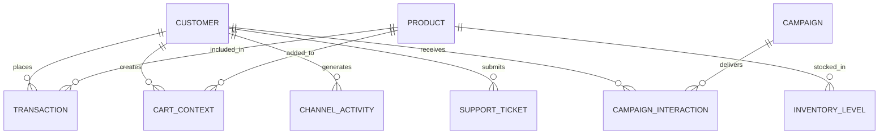

# Retail Data Pipeline: Entity-Relationship (ER) Architecture

This document outlines the **Entity-Relationship (ER) model**, **cardinality rules**, and **key attributes** for the 9 operational retail tables.

---

## 1. Quick Summary: Strong vs. Weak Entities

| Entity Name | Category | Why? | Primary Key |
| :--- | :--- | :--- | :--- |
| **`CUSTOMER`** | 🟩 **Strong** | Exists independently as a person/buyer | `customer_id` |
| **`PRODUCT`** | 🟩 **Strong** | Exists independently as a catalog item | `product_id` |
| **`CAMPAIGN`** | 🟩 **Strong** | Exists independently as a marketing initiative | `campaign_id` |
| **`INVENTORY_LEVEL`** | 🟨 **Weak** | Dependent on `PRODUCT` and location | `inventory_id` |
| **`TRANSACTION`** | 🟨 **Weak** | Dependent on `CUSTOMER` who made the purchase | `transaction_id` |
| **`CART_CONTEXT`** | 🟨 **Weak** | Dependent on `CUSTOMER` currently shopping | `cart_id` |
| **`CHANNEL_ACTIVITY`**| 🟨 **Weak** | Dependent on `CUSTOMER` browsing clickstream | `activity_id` |
| **`SUPPORT_TICKET`** | 🟨 **Weak** | Dependent on `CUSTOMER` filing a grievance | `ticket_id` |
| **`CAMPAIGN_INTERACTION`**| 🟨 **Weak / Bridge**| Dependent on both `CUSTOMER` and `CAMPAIGN` | `interaction_id` |

> * **Strong Entity**: Has independent existence and its own standalone business identity.
> * **Weak Entity**: Dependent on a parent entity; without the parent, it has no business meaning.

---

## 2. Visual Entity-Relationship (ER) Diagram

---

## 3. Relationships & Cardinality

### Cardinality Notation Guide
* **`1 : 1`** *(One-to-One)*: One parent record maps to exactly one child record.
* **`1 : N`** *(One-to-Many)*: One parent record can have zero, one, or many child records.
* **`M : N`** *(Many-to-Many)*: Many records on one side connect to many records on the other (resolved via line items or bridge tables).

---

### Core Relationship Matrix

| # | Parent Entity | Child Entity | Cardinality | Foreign Key | Simple Business Meaning |
|:--|:---|:---|:---:|:---|:---|
| 1 | **`CUSTOMER`** | `TRANSACTION` | **`1 : N`** | `customer_id` | One customer can make **many** purchases over time. |
| 2 | **`CUSTOMER`** | `CART_CONTEXT` | **`1 : N`** | `customer_id` | One customer can have **active/past** carts across sessions. |
| 3 | **`CUSTOMER`** | `CHANNEL_ACTIVITY` | **`1 : N`** | `customer_id` | One customer generates **many** page views and clicks. |
| 4 | **`CUSTOMER`** | `SUPPORT_TICKET` | **`1 : N`** | `customer_id` | One customer can submit **zero or many** support tickets. |
| 5 | **`CUSTOMER`** | `CAMPAIGN_INTERACTION` | **`1 : N`** | `customer_id` | One customer can receive and respond to **many** campaigns. |
| 6 | **`CAMPAIGN`** | `CAMPAIGN_INTERACTION` | **`1 : N`** | `campaign_id` | One campaign is sent to **many** target customers. |
| 7 | **`PRODUCT`** | `INVENTORY_LEVEL` | **`1 : N`** | `product_id` | One product is stocked across **many** stores and DCs. |
| 8 | **`PRODUCT`** | `CART_CONTEXT` | **`M : N`** | `product_id` *(in items)* | Many products can sit inside many customer carts. |
| 9 | **`PRODUCT`** | `TRANSACTION` | **`M : N`** | `product_id` *(in items)* | Many products can be bought in many transactions. |

---

## 4. Entity Attributes Reference

### 1. Strong Entities

* **`CUSTOMER` (`tbl_customer_profiles`)**
  * **Primary Key (PK)**: `customer_id`
  * **Attributes**: `first_name`, `last_name`, `age`, `gender`, `email`, `phone`, `state`, `loyalty_tier`, `points_balance`, `consent_email`, `consent_sms`

* **`PRODUCT` (`tbl_product_catalog`)**
  * **Primary Key (PK)**: `product_id`
  * **Attributes**: `product_name`, `brand`, `category`, `sub_category`, `base_price`, `cost_price`, `margin_rate`, `is_clearance`, `is_active`

* **`CAMPAIGN` (`tbl_campaigns`)**
  * **Primary Key (PK)**: `campaign_id`
  * **Attributes**: `campaign_name`, `channel`, `offer_type`, `promo_code`, `discount_percentage`, `min_spend_threshold`, `budget_allocated`, `start_date`, `end_date`

---

### 2. Weak Entities

* **`INVENTORY_LEVEL` (`tbl_inventory_levels`)**
  * **Primary Key (PK)**: `inventory_id`
  * **Foreign Key (FK)**: `product_id` $\rightarrow$ `PRODUCT`
  * **Attributes**: `location_id`, `location_type`, `available_quantity`, `reserved_quantity`, `inventory_status`, `days_of_supply`

* **`TRANSACTION` (`tbl_transactions`)**
  * **Primary Key (PK)**: `transaction_id`
  * **Foreign Key (FK)**: `customer_id` $\rightarrow$ `CUSTOMER`
  * **Attributes**: `store_id`, `channel`, `gross_total`, `discount_total`, `net_total`, `items_array`, `transaction_timestamp`

* **`CART_CONTEXT` (`tbl_cart_contexts`)**
  * **Primary Key (PK)**: `cart_id`
  * **Foreign Key (FK)**: `customer_id` $\rightarrow$ `CUSTOMER`, `session_id` $\rightarrow$ `CHANNEL_ACTIVITY`
  * **Attributes**: `cart_value`, `item_count`, `primary_category`, `cart_status`, `items_array`, `cart_timestamp`

* **`CHANNEL_ACTIVITY` (`tbl_channel_activities`)**
  * **Primary Key (PK)**: `activity_id`
  * **Foreign Key (FK)**: `customer_id` $\rightarrow$ `CUSTOMER`
  * **Attributes**: `session_id`, `channel`, `device_type`, `event_type_detail`, `page_category`, `duration_seconds`, `activity_timestamp`

* **`SUPPORT_TICKET` (`tbl_support_tickets`)**
  * **Primary Key (PK)**: `ticket_id`
  * **Foreign Key (FK)**: `customer_id` $\rightarrow$ `CUSTOMER`
  * **Attributes**: `category`, `severity`, `ticket_status`, `is_escalated`, `resolution_time_hours`, `satisfaction_score`, `ticket_timestamp`

* **`CAMPAIGN_INTERACTION` (`tbl_campaign_interactions`)**
  * **Primary Key (PK)**: `interaction_id`
  * **Foreign Keys (FK)**: `customer_id` $\rightarrow$ `CUSTOMER`, `campaign_id` $\rightarrow$ `CAMPAIGN`
  * **Attributes**: `channel`, `response_action`, `promo_code_used`, `redemption_value`, `interaction_timestamp`

