# Inventory & Fulfilment – Simplified Data Model

This document explains the data model in simple terms: **table names**, **entity types** (Strong vs. Weak), **model types** (Dimension vs. Fact), **attributes**, and **relationships with cardinality**.

---

## 1. Quick Reference: All Tables at a Glance

| Table Name | Entity Type | Model Type | Primary Key (PK) | Foreign Keys (FK) | Simple Description |
| :--- | :--- | :--- | :--- | :--- | :--- |
| **`PRODUCTS`** | **Strong Entity** | **Dimension** | `sku_id` | *None* | Master catalog of items we sell. |
| **`LOCATIONS`** | **Strong Entity** | **Dimension** | `location_id` | `parent_dc_id` | Master list of DCs, stores, and 3PLs. |
| **`CARRIERS`** | **Strong Entity** | **Dimension** | `carrier_id` | *None* | Freight and parcel delivery companies. |
| **`CALENDAR`** | **Strong Entity** | **Dimension** | `calendar_date` | *None* | Operating days, holidays, and peak seasons. |
| **`SUPPLIERS`** | **Weak (Associative)** | **Dimension / Bridge** | Composite `(supplier_id, sku_id)` | `sku_id` | Sourcing terms, lead times, and MOQs per SKU. |
| **`INVENTORY_SNAPSHOTS`** | **Weak Entity** | **Fact (Snapshot)** | Composite `(snapshot_date, sku_id, location_id)` | `sku_id`, `location_id` | Daily stock balances: on-hand, reserved, stockout. |
| **`INVENTORY_MOVEMENTS`** | **Weak Entity** | **Fact (Transaction)** | `movement_id` | `sku_id`, `location_id` | Physical stock transactions: receipts, sales, losses. |
| **`SALES_DEMAND`** | **Weak Entity** | **Fact (Periodic)** | Composite `(sales_date, sku_id, location_id, channel)` | `sku_id`, `location_id` | Daily units sold and revenue per store and channel. |
| **`TRANSFERS`** | **Weak Entity** | **Fact (Transaction)** | `transfer_id` | `from_location_id`, `to_location_id`, `sku_id` | Stock shipments between DCs and retail stores. |
| **`PROMOTIONS`** | **Weak (Associative)** | **Fact / Bridge** | Composite `(promo_id, sku_id)` | `sku_id` | Promotional campaigns and discounts per SKU. |
| **`PURCHASE_ORDERS`** | **Weak Entity** | **Fact (Transaction Line)**| `po_id` (or composite with `sku_id`) | `sku_id`, `supplier_id`, `destination_location_id` | Purchase orders sent to suppliers and arrival dates. |
| **`CUSTOMER_ORDERS`** | **Weak Entity** | **Fact (Transaction Line)**| Composite `(order_id, sku_id)` | `sku_id`, `fulfilled_from_location_id` | Online customer orders and item lines. |
| **`SHIPMENTS`** | **Weak Entity** | **Fact (Milestone)** | Composite `(shipment_id, event_seq)` | `order_id`, `origin_location_id`, `carrier_id` | Carrier tracking events, ship time, late flag. |
| **`DOCUMENTS`** | **Weak Entity** | **Knowledge Base** | `doc_id` | `supplier_id`, `carrier_id` | Supplier contracts, warehouse SOPs, carrier guides. |

---

## 2. Core Concepts Made Simple

### 2.1 Strong Entity vs. Weak Entity
* **Strong Entity (Independent):** 
  * Exists on its own in the real world. 
  * Does not depend on any other table to exist.
  * Has its own independent primary key.
  * *Example:* A **Product** (`sku_id`) or a **Location** (`location_id`) exists in our master catalog whether or not any stock has been sold.
* **Weak Entity (Dependent):**
  * Cannot exist without a parent entity.
  * If the parent entity is deleted, this record has no meaning.
  * Its identity relies on foreign keys pointing to parent tables.
  * *Example:* An **Inventory Snapshot** cannot exist without a Product and a Location. If you don't know which product and which store, the stock count is meaningless.

### 2.2 Dimension vs. Fact Table
* **Dimension Table (Context / "Who, What, Where, When"):**
  * Stores descriptive attributes and master data (names, categories, addresses, types).
  * Usually has fewer rows and many descriptive text columns.
  * *Examples:* `PRODUCTS`, `LOCATIONS`, `CARRIERS`, `CALENDAR`, `SUPPLIERS`.
* **Fact Table (Measurements / "How Much, How Many"):**
  * Stores numerical metrics, quantities, balances, and operational events.
  * References dimension tables through foreign keys.
  * *Examples:* `SALES_DEMAND` (units sold), `INVENTORY_SNAPSHOTS` (stock quantities), `PURCHASE_ORDERS` (ordered units), `SHIPMENTS` (shipping cost, transit time).

### 2.3 Cardinality Made Simple
* **`1:1` (One-to-One):** 1 record in Table A connects to at most 1 record in Table B.
  * *Example:* 1 Customer Order connects to 1 Shipment (unless split into multiple shipments).
* **`1:N` (One-to-Many):** 1 record in Table A connects to many records in Table B.
  * *Example:* 1 Location has Many Daily Inventory Snapshots.
* **`M:N` (Many-to-Many):** Many records in Table A connect to many records in Table B.
  * *Example:* One Supplier provides Many Products, and one Product can be bought from Many Suppliers. This is resolved using `SUPPLIERS` as an associative bridge table.

---

## 3. Entity-Relationship (ER) Diagram

```mermaid
erDiagram
    %% =========================================================================
    %% 1. STRONG MASTER DIMENSIONS (True Single Primary Keys)
    %% =========================================================================
    PRODUCTS {
        varchar sku_id PK "Unique Stock Keeping Unit Code"
        varchar product_name "Product Commercial Name"
        varchar category "Product Taxonomy Group"
        varchar brand "Manufacturer Brand"
        varchar abc_class "Importance Tier (A, B, C)"
        decimal unit_cost "Procurement Unit Cost"
        decimal unit_price "Retail Selling Price"
        int case_pack_qty "Units per Supplier Master Carton"
        decimal weight_kg "Unit Physical Weight"
        int shelf_life_days "Perishability Expiry Window"
        varchar status "Lifecycle Status (NEW, ACTIVE, DISCONTINUED)"
        date launch_date "Commercial Launch Date"
    }

    LOCATIONS {
        varchar location_id PK "Unique Facility Node Code"
        varchar location_type "Node Type (DC, STORE, 3PL)"
        varchar region "Geographic Operating Region"
        varchar postal_code "Facility Postal Code"
        float latitude "Geocoded Latitude"
        float longitude "Geocoded Longitude"
        varchar parent_dc_id FK "Supplying Master Distribution Center"
        int storage_capacity "Max Physical Capacity in Units"
        int daily_order_capacity "Max Outbound Picking Capacity"
        time cutoff_time "Daily Same-Day Dispatch Cutoff"
        boolean is_active "Operational Status Flag"
    }

    CARRIERS {
        varchar carrier_id PK "Unique Freight Carrier ID"
        varchar carrier_name "Logistics Carrier Business Name"
        varchar service_level "Service Tier (SAME_DAY, NEXT_DAY, STANDARD)"
        int promised_transit_days "Contractual Transit SLA Days"
        decimal base_rate "Baseline Shipping Rate per Parcel"
    }

    CALENDAR {
        date calendar_date PK "Calendar Day Date"
        boolean is_holiday "Public / Regional Holiday Flag"
        varchar holiday_name "Holiday Name or Occasion"
        int week "Fiscal Calendar Week"
        int month "Calendar Month Number"
        varchar season "Retail Seasonality Grouping"
        boolean is_peak_period "High-Volume Peak Season Flag"
    }

    %% =========================================================================
    %% 2. PROCUREMENT & SUPPLIERS
    %% =========================================================================
    SUPPLIERS {
        varchar supplier_id "Vendor ID (repeats per SKU)"
        varchar sku_id FK "Supplied Product SKU Reference"
        varchar supplier_name "Vendor Registered Entity Name"
        varchar country "Manufacturing / Sourcing Country"
        int promised_lead_time_days "Contractual Lead Time SLA"
        int moq "Minimum Order Quantity"
        decimal contract_unit_cost "Contracted Unit Procurement Cost"
        boolean is_preferred "Primary Preferred Sourcing Flag"
        boolean is_active "Vendor Active Sourcing Status"
    }

    PURCHASE_ORDERS {
        varchar po_id "Purchase Order Number"
        varchar sku_id FK "Ordered Product SKU Reference"
        varchar supplier_id FK "Vendor Sourcing Code"
        varchar destination_location_id FK "Receiving Facility Node"
        int ordered_qty "Committed Order Quantity"
        int received_qty "Actual Inbound Received Quantity"
        date order_date "PO Emission Date"
        date expected_delivery_date "Expected Delivery Date"
        date actual_delivery_date "Actual Inbound Gate Receipt Date"
        varchar status "PO Status (OPEN, RECEIVED, PARTIAL)"
        decimal unit_cost "Agreed Procurement Price"
    }

    %% =========================================================================
    %% 3. INVENTORY BALANCES & MOVEMENTS
    %% =========================================================================
    INVENTORY_SNAPSHOTS {
        date snapshot_date "Snapshot Date (repeats per SKU-Location)"
        varchar sku_id FK "Product Reference"
        varchar location_id FK "Facility Node Reference"
        int on_hand_qty "Physical Units in Stock"
        int reserved_qty "Units Reserved for Orders"
        int available_qty "Free Stock (On-Hand - Reserved)"
        int in_transit_qty "Inbound Stock En Route"
        int damaged_qty "Quarantined Damaged Units"
        int safety_stock_qty "Dynamic Policy Safety Stock"
        boolean is_stockout "Stock-out Status Flag"
    }

    INVENTORY_MOVEMENTS {
        varchar movement_id PK "Unique Inventory Ledger Event ID"
        varchar sku_id FK "Product Reference"
        varchar location_id FK "Facility Node Reference"
        varchar movement_type "Type (RECEIPT, SALE, TRANSFER, etc.)"
        int quantity "Signed Transaction Quantity (+/-)"
        varchar reference_id "Originating Document Ref (PO/Order)"
        varchar reason_code "Adjustment Reason Code"
        timestamp event_timestamp "Transaction System Timestamp"
    }

    TRANSFERS {
        varchar transfer_id PK "Unique Stock Transfer ID"
        varchar from_location_id FK "Dispatching Origin Location"
        varchar to_location_id FK "Receiving Destination Location"
        varchar sku_id FK "Transferred Product Reference"
        int qty "Transferred Unit Quantity"
        date shipped_date "Physical Dispatch Date"
        date received_date "Physical Inbound Receipt Date"
        varchar status "Transfer Status (IN_TRANSIT, COMPLETED)"
    }

    %% =========================================================================
    %% 4. SALES DEMAND & PROMOTIONS
    %% =========================================================================
    SALES_DEMAND {
        date sales_date "Sales Date (repeats per SKU-Location-Channel)"
        varchar sku_id FK "Product Reference"
        varchar location_id FK "Fulfillment Location Reference"
        varchar channel "Sales Channel (IN_STORE, WEB, APP)"
        int units_sold "Gross Units Sold"
        decimal sales_amount "Gross Revenue Recorded"
        decimal avg_selling_price "Effective Realized Selling Price"
        int units_returned "Customer Returned Units"
    }

    PROMOTIONS {
        varchar promo_id "Promotion Campaign Code (repeats per SKU)"
        varchar sku_id FK "Applicable Product Reference"
        varchar promo_type "Campaign Type (PRICE_CUT, BOGO)"
        int discount_pct "Discount Percentage"
        date start_date "Promotional Window Start"
        date end_date "Promotional Window End"
        varchar region "Geographic Target Region"
    }

    %% =========================================================================
    %% 5. CUSTOMER ORDERS & SHIPMENTS
    %% =========================================================================
    CUSTOMER_ORDERS {
        varchar order_id "Customer Order ID (repeats per item line)"
        varchar sku_id FK "Ordered Product Line SKU Reference"
        varchar customer_id "Pseudonymous Customer Identifier"
        varchar customer_name "Masked Customer PII"
        varchar address "Masked Street Address"
        varchar phone "Masked Contact Phone"
        varchar delivery_postal_code "Delivery Destination Postal Code"
        varchar delivery_region "Delivery Destination Region"
        timestamp order_timestamp "Checkout Timestamp"
        date promised_delivery_date "Promised Delivery Date SLA"
        varchar service_level "Shipping Class SLA"
        varchar fulfilled_from_location_id FK "Sourcing Fulfillment Node"
        int qty "Ordered Line Item Quantity"
        varchar order_status "Status (CREATED, PACKED, SHIPPED, DELIVERED)"
        boolean is_split_shipment "Split Fulfillment Flag"
    }

    SHIPMENTS {
        varchar shipment_id "Shipment Tracking ID (repeats per event)"
        int event_seq "Milestone Event Sequence (1, 2, 3...)"
        varchar order_id FK "Customer Sales Order Reference"
        varchar origin_location_id FK "Dispatching Warehouse / Store"
        varchar carrier_id FK "Contracted Logistics Carrier"
        varchar service_level "Carrier Service Level"
        timestamp ship_timestamp "Outbound Dock Dispatch Timestamp"
        timestamp delivered_timestamp "Final Inbound Delivery Timestamp"
        decimal shipping_cost "Freight and Parcel Incurred Cost"
        varchar event_type "Status (PICKED_UP, IN_TRANSIT, DELAYED, DELIVERED)"
        varchar delay_note "Free-text Carrier Exception Notes"
        boolean is_late "Delivery SLA Breach Indicator"
    }

    %% =========================================================================
    %% 6. GOVERNANCE DOCUMENTS
    %% =========================================================================
    DOCUMENTS {
        varchar doc_id PK "Unique Document Identifier"
        varchar file_name "Source PDF File Name"
        varchar doc_type "Type (CONTRACT, SOP, CARRIER_GUIDE)"
        varchar supplier_id FK "Associated Supplier Reference"
        varchar carrier_id FK "Associated Carrier Reference"
        date effective_date "Legal Validity Start Date"
        varchar stage_file_path "Internal Stage URI"
    }

    %% =========================================================================
    %% RELATIONSHIPS WITH CARDINALITY
    %% =========================================================================
    PRODUCTS ||--o{ INVENTORY_SNAPSHOTS : "tracked in"
    LOCATIONS ||--o{ INVENTORY_SNAPSHOTS : "stored at"
    CALENDAR ||--o{ INVENTORY_SNAPSHOTS : "dated on"

    PRODUCTS ||--o{ INVENTORY_MOVEMENTS : "moved in"
    LOCATIONS ||--o{ INVENTORY_MOVEMENTS : "logged at"

    PRODUCTS ||--o{ SALES_DEMAND : "demanded as"
    LOCATIONS ||--o{ SALES_DEMAND : "sold through"
    CALENDAR ||--o{ SALES_DEMAND : "transacted on"

    PRODUCTS ||--o{ SUPPLIERS : "sourced through"
    PRODUCTS ||--o{ PROMOTIONS : "discounted in"

    PRODUCTS ||--o{ TRANSFERS : "transferred as"
    LOCATIONS ||--o{ TRANSFERS : "dispatched from"
    LOCATIONS ||--o{ TRANSFERS : "received at"

    PRODUCTS ||--o{ PURCHASE_ORDERS : "procured as"
    SUPPLIERS ||--o{ PURCHASE_ORDERS : "supplied by"
    LOCATIONS ||--o{ PURCHASE_ORDERS : "delivered to"

    PRODUCTS ||--o{ CUSTOMER_ORDERS : "ordered as"
    LOCATIONS ||--o{ CUSTOMER_ORDERS : "fulfilled by"

    CUSTOMER_ORDERS ||--o{ SHIPMENTS : "dispatched via"
    LOCATIONS ||--o{ SHIPMENTS : "shipped from"
    CARRIERS ||--o{ SHIPMENTS : "transported by"

    LOCATIONS ||--o{ LOCATIONS : "replenished by parent DC"

    SUPPLIERS ||--o{ DOCUMENTS : "governed by contract"
    CARRIERS ||--o{ DOCUMENTS : "governed by service guide"
```



---

## 4. Simple Breakdown by Table

### 4.1 Master Dimension Tables (Who & What)

#### 1. `PRODUCTS`
* **Entity Type:** Strong Entity
* **Model Type:** Dimension (`DIM_PRODUCT`)
* **Primary Key:** `sku_id`
* **Foreign Keys:** None
* **Attributes:** `product_name`, `category`, `brand`, `abc_class`, `unit_cost`, `unit_price`, `case_pack_qty`, `weight_kg`, `shelf_life_days`, `status`, `launch_date`
* **Relationships:** Parent to Snapshots (1:N), Sales Demand (1:N), Purchase Orders (1:N), Customer Orders (1:N)

#### 2. `LOCATIONS`
* **Entity Type:** Strong Entity
* **Model Type:** Dimension (`DIM_LOCATION`)
* **Primary Key:** `location_id`
* **Foreign Keys:** `parent_dc_id` (points to supplying DC)
* **Attributes:** `location_type` (DC, STORE, 3PL), `region`, `postal_code`, `latitude`, `longitude`, `parent_dc_id`, `storage_capacity`, `daily_order_capacity`, `cutoff_time`, `is_active`
* **Relationships:** Parent to Snapshots (1:N), Sales Demand (1:N), Orders (1:N), Transfers (1:N)

#### 3. `CARRIERS`
* **Entity Type:** Strong Entity
* **Model Type:** Dimension (`DIM_CARRIER`)
* **Primary Key:** `carrier_id`
* **Foreign Keys:** None
* **Attributes:** `carrier_name`, `service_level` (SAME_DAY, NEXT_DAY, STANDARD), `promised_transit_days`, `base_rate`
* **Relationships:** Parent to Shipments (1:N)

#### 4. `CALENDAR`
* **Entity Type:** Strong Entity
* **Model Type:** Dimension (`DIM_DATE`)
* **Primary Key:** `calendar_date`
* **Foreign Keys:** None
* **Attributes:** `is_holiday`, `holiday_name`, `week`, `month`, `season`, `is_peak_period`
* **Relationships:** Parent to Snapshots (1:N) and Sales Demand (1:N)

#### 5. `SUPPLIERS`
* **Entity Type:** Weak (Associative Entity)
* **Model Type:** Dimension / Bridge (`DIM_SUPPLIER_CATALOG`)
* **Primary Key:** Composite `(supplier_id, sku_id)`
* **Foreign Keys:** `sku_id FK` $\rightarrow$ `PRODUCTS.sku_id`
* **Attributes:** `supplier_name`, `country`, `promised_lead_time_days`, `moq`, `contract_unit_cost`, `is_preferred`, `is_active`
* **Relationships:** Child of Products (1:N), Parent to Purchase Orders (1:N)

---

### 4.2 Operational & Transactional Fact Tables (How Much & When)

#### 6. `INVENTORY_SNAPSHOTS`
* **Entity Type:** Weak Entity
* **Model Type:** Fact (Periodic Snapshot)
* **Primary Key:** Composite `(snapshot_date, sku_id, location_id)`
* **Foreign Keys:** `sku_id FK` $\rightarrow$ `PRODUCTS`, `location_id FK` $\rightarrow$ `LOCATIONS`
* **Attributes:** `on_hand_qty`, `reserved_qty`, `available_qty`, `in_transit_qty`, `damaged_qty`, `safety_stock_qty`, `is_stockout`

#### 7. `INVENTORY_MOVEMENTS`
* **Entity Type:** Weak Entity
* **Model Type:** Fact (Transaction Ledger)
* **Primary Key:** `movement_id`
* **Foreign Keys:** `sku_id FK` $\rightarrow$ `PRODUCTS`, `location_id FK` $\rightarrow$ `LOCATIONS`
* **Attributes:** `movement_type` (RECEIPT, SALE, ADJUSTMENT, RETURN, WRITE_OFF), `quantity`, `reference_id`, `reason_code`, `event_timestamp`

#### 8. `SALES_DEMAND`
* **Entity Type:** Weak Entity
* **Model Type:** Fact (Periodic Sales)
* **Primary Key:** Composite `(sales_date, sku_id, location_id, channel)`
* **Foreign Keys:** `sku_id FK` $\rightarrow$ `PRODUCTS`, `location_id FK` $\rightarrow$ `LOCATIONS`
* **Attributes:** `units_sold`, `sales_amount`, `avg_selling_price`, `units_returned`

#### 9. `TRANSFERS`
* **Entity Type:** Weak Entity
* **Model Type:** Fact (Transaction)
* **Primary Key:** `transfer_id`
* **Foreign Keys:** `from_location_id FK` $\rightarrow$ `LOCATIONS`, `to_location_id FK` $\rightarrow$ `LOCATIONS`, `sku_id FK` $\rightarrow$ `PRODUCTS`
* **Attributes:** `qty`, `shipped_date`, `received_date`, `status` (IN_TRANSIT, COMPLETED)

#### 10. `PROMOTIONS`
* **Entity Type:** Weak (Associative Entity)
* **Model Type:** Fact / Bridge
* **Primary Key:** Composite `(promo_id, sku_id)`
* **Foreign Keys:** `sku_id FK` $\rightarrow$ `PRODUCTS`
* **Attributes:** `promo_type` (PRICE_CUT, BOGO), `discount_pct`, `start_date`, `end_date`, `region`

#### 11. `PURCHASE_ORDERS`
* **Entity Type:** Weak Entity
* **Model Type:** Fact (Transaction Line)
* **Primary Key:** `po_id` (or composite `(po_id, sku_id)`)
* **Foreign Keys:** `sku_id FK` $\rightarrow$ `PRODUCTS`, `supplier_id FK` $\rightarrow$ `SUPPLIERS`, `destination_location_id FK` $\rightarrow$ `LOCATIONS`
* **Attributes:** `ordered_qty`, `received_qty`, `order_date`, `expected_delivery_date`, `actual_delivery_date`, `status`, `unit_cost`

#### 12. `CUSTOMER_ORDERS`
* **Entity Type:** Weak Entity
* **Model Type:** Fact (Transaction Line)
* **Primary Key:** Composite `(order_id, sku_id)`
* **Foreign Keys:** `sku_id FK` $\rightarrow$ `PRODUCTS`, `fulfilled_from_location_id FK` $\rightarrow$ `LOCATIONS`
* **Attributes:** `customer_id`, `customer_name` (masked), `address` (masked), `phone` (masked), `delivery_postal_code`, `delivery_region`, `order_timestamp`, `promised_delivery_date`, `service_level`, `qty`, `order_status`, `is_split_shipment`

#### 13. `SHIPMENTS`
* **Entity Type:** Weak Entity
* **Model Type:** Fact (Milestone Event)
* **Primary Key:** Composite `(shipment_id, event_seq)`
* **Foreign Keys:** `order_id FK` $\rightarrow$ `CUSTOMER_ORDERS`, `origin_location_id FK` $\rightarrow$ `LOCATIONS`, `carrier_id FK` $\rightarrow$ `CARRIERS`
* **Attributes:** `ship_timestamp`, `delivered_timestamp`, `shipping_cost`, `event_type` (PICKED_UP, DELAYED, DELIVERED), `delay_note`, `is_late`

#### 14. `DOCUMENTS`
* **Entity Type:** Weak Entity
* **Model Type:** Knowledge Base
* **Primary Key:** `doc_id`
* **Foreign Keys:** `supplier_id FK` $\rightarrow$ `SUPPLIERS`, `carrier_id FK` $\rightarrow$ `CARRIERS`
* **Attributes:** `file_name`, `doc_type` (CONTRACT, SOP, CARRIER_GUIDE), `effective_date`, `stage_file_path`

---

## 5. Relationships & Cardinality Matrix

| Parent Table (1) | Child Table (N) | Cardinality | Join Keys | Business Rule |
| :--- | :--- | :---: | :--- | :--- |
| **`PRODUCTS`** | `INVENTORY_SNAPSHOTS` | `1:N` | `sku_id` | One product has daily stock counts across multiple locations. |
| **`LOCATIONS`** | `INVENTORY_SNAPSHOTS` | `1:N` | `location_id` | One location stores daily balances for hundreds of products. |
| **`CALENDAR`** | `INVENTORY_SNAPSHOTS` | `1:N` | `calendar_date = snapshot_date` | One date has a snapshot for each active product-location pair. |
| **`PRODUCTS`** | `SALES_DEMAND` | `1:N` | `sku_id` | One product has daily sales records across channels. |
| **`LOCATIONS`** | `SALES_DEMAND` | `1:N` | `location_id` | One location generates sales across multiple products. |
| **`CALENDAR`** | `SALES_DEMAND` | `1:N` | `calendar_date = sales_date` | One calendar day aggregates sales across the store network. |
| **`PRODUCTS`** | `SUPPLIERS` | `1:N` | `sku_id` | One product can be sourced from multiple approved suppliers. |
| **`PRODUCTS`** | `PROMOTIONS` | `1:N` | `sku_id` | One product can have multiple promotions over the year. |
| **`SUPPLIERS`** | `PURCHASE_ORDERS` | `1:N` | `supplier_id` | One supplier receives many purchase orders. |
| **`LOCATIONS`** | `PURCHASE_ORDERS` | `1:N` | `location_id = destination_location_id` | One DC receives inbound purchase orders. |
| **`PRODUCTS`** | `PURCHASE_ORDERS` | `1:N` | `sku_id` | One product is purchased across many purchase orders. |
| **`LOCATIONS`** | `TRANSFERS` (Origin) | `1:N` | `location_id = from_location_id` | One DC sends transfers to stores. |
| **`LOCATIONS`** | `TRANSFERS` (Destination) | `1:N` | `location_id = to_location_id` | One store receives transfers from a DC. |
| **`PRODUCTS`** | `TRANSFERS` | `1:N` | `sku_id` | One product is moved across facilities. |
| **`LOCATIONS`** | `CUSTOMER_ORDERS` | `1:N` | `location_id = fulfilled_from_location_id`| One facility fulfills many customer orders. |
| **`PRODUCTS`** | `CUSTOMER_ORDERS` | `1:N` | `sku_id` | One product appears in many customer orders. |
| **`CUSTOMER_ORDERS`** | `SHIPMENTS` | `1:1` or `1:N` | `order_id` | One order has one shipment (or multiple if split). |
| **`CARRIERS`** | `SHIPMENTS` | `1:N` | `carrier_id` | One carrier delivers many shipments. |
| **`LOCATIONS`** | `SHIPMENTS` | `1:N` | `location_id = origin_location_id` | One facility hands over packages to carriers. |
| **`LOCATIONS`** | `LOCATIONS` | `0..1:N` | `parent_dc_id = location_id` | One DC replenishes multiple retail stores. |
| **`SUPPLIERS`** | `DOCUMENTS` | `0..1:N` | `supplier_id` | One supplier has contracts and SLA documents. |
| **`CARRIERS`** | `DOCUMENTS` | `0..1:N` | `carrier_id` | One carrier has service guides and rate sheets. |

---

## 6. How the Data Powers the 3 ML Decisions

```
┌────────────────────────────────────────────────────────────────────────────────────────┐
│                        DATA MODEL TO DECISION ENGINE MAPPING                           │
└────────────────────────────────────────────────────────────────────────────────────────┘

1. M1: Demand Forecast & Stock-out Risk
   • Input Tables: SALES_DEMAND, PRODUCTS, CALENDAR, PROMOTIONS, INVENTORY_SNAPSHOTS
   • What ML Predicts: Daily units sold for each SKU at each Location.
   • What is Calculated: If (On-Hand + In-Transit + Open POs - Forecast) <= 0, flag Stock-out Risk!

2. M2: Replenishment Recommendations & Lead Time
   • Input Tables: PURCHASE_ORDERS, SUPPLIERS, PRODUCTS, INVENTORY_SNAPSHOTS, TRANSFERS
   • What ML Predicts: Actual delivery lead time (days) for each supplier.
   • What is Calculated: Order Qty = Forecast over Lead Time + Safety Stock - Current Stock.
   • Human Approval: Planner reviews and approves in the UI before placing the PO.

3. M3: Late Delivery Risk & Sourcing Node Optimization
   • Input Tables: CUSTOMER_ORDERS, SHIPMENTS, CARRIERS, LOCATIONS, INVENTORY_SNAPSHOTS
   • What ML Predicts: Chance that an open order will be delivered late (SLA breach).
   • What is Ranked: Evaluates candidate nodes with available stock to pick the best node.
```

---
*End of Simplified Data Model Specification.*
