# Inventory & Fulfilment – Medallion Data Model (Silver, Gold, ML)

This document specifies the complete data model for the Inventory & Fulfilment use case across the **Silver**, **Gold**, and **ML** layers.

---

## 1. Medallion Layer Architecture

```
┌─────────────────────────────────────────────────────────────────────────────────────────────────┐
│                                 SNOWFLAKE DATA FLOW PIPELINE                                    │
└─────────────────────────────────────────────────────────────────────────────────────────────────┘

  1. RAW (Stages)         ──► Files land on @RAW.STG_SC_INGRESS (CSV, JSON) and @RAW.STG_SC_DOCUMENTS (PDF)
         │
         ▼ (COPY INTO)
  2. BRONZE (Raw Tables)  ──► Append-only raw copies (VARIANT for JSON, typed staging for CSV) + CDC Streams
         │
         ▼ (dbt transformations & Data Quality tests)
  3. SILVER (Canonical)   ──► Cleaned, normalized Entities (Dimensions) & Operational Facts (Transactions)
         │
         ▼ (Feature Store, Aggregations, Cortex Vector Indexing)
  4. GOLD (Data Products) ──► ML Feature Views, Business Aggregates, Semantic View & Cortex Search Service
         │
         ▼ (Model Execution: M1, M2, M3 scoring tasks)
  5. ML SCHEMA (Outputs)  ──► Forecasts, Stock-out Risks, Replenishment Recs, Late SLA Risks & Approval Audit
```

---

## 2. All Objects at a Glance

### 2.1 Silver Layer (Canonical Entities & Cleaned Facts)
*All tables live in schema `SILVER`.*

| Table Name | Entity Type | Model Type | Primary Key (PK) | Foreign Keys (FK) | Description |
| :--- | :--- | :--- | :--- | :--- | :--- |
| **`PRODUCT_ENTITY`** | Strong Entity | Dimension | `sku_id` | *None* | Canonical catalog of all products, dimensions, costs, retail prices. |
| **`LOCATION_ENTITY`** | Strong Entity | Dimension | `location_id` | `parent_dc_id` | Master list of DCs, retail stores, and 3PLs with capacities and cutoffs. |
| **`SUPPLIER_ENTITY`** | Strong Entity | Dimension | `supplier_id` | *None* | Master vendor records, country of origin, active status. |
| **`SUPPLIER_SKU_TERMS`** | Associative | Dimension / Bridge | Composite `(supplier_id, sku_id)` | `supplier_id`, `sku_id` | Sourcing terms, contractual lead time, MOQ, unit cost per SKU. |
| **`CARRIER_ENTITY`** | Strong Entity | Dimension | `carrier_id` | *None* | Logistics delivery providers, service tiers, base rates. |
| **`CALENDAR_DIM`** | Strong Entity | Dimension | `calendar_date` | *None* | Operating calendar, fiscal weeks/months, holidays, peak seasons. |
| **`INVENTORY_SNAPSHOT_FACT`** | Weak Entity | Fact (Periodic Snapshot) | Composite `(snapshot_date, sku_id, location_id)` | `sku_id`, `location_id` | Daily stock balances: on-hand, reserved, available, in-transit, stockout flag. |
| **`INVENTORY_MOVEMENT_FACT`** | Weak Entity | Fact (Transaction Ledger) | `movement_id` | `sku_id`, `location_id` | Stock movement transactions: receipts, sales, returns, adjustments, write-offs. |
| **`SALES_DEMAND_FACT`** | Weak Entity | Fact (Periodic Sales) | Composite `(sales_date, sku_id, location_id, channel)` | `sku_id`, `location_id` | Daily units sold, revenue, realised price, returned units per store and channel. |
| **`TRANSFERS_FACT`** | Weak Entity | Fact (Transaction) | `transfer_id` | `from_location_id`, `to_location_id`, `sku_id` | Stock shipments between DCs and retail stores. |
| **`PROMOTIONS_FACT`** | Associative | Fact / Bridge | Composite `(promo_id, sku_id)` | `sku_id` | Promotional campaigns, discount depths, target regions and categories. |
| **`PURCHASE_ORDER_FACT`** | Weak Entity | Fact (Transaction Line) | Composite `(po_id, sku_id)` | `po_id`, `sku_id`, `supplier_id`, `destination_location_id` | Inbound purchase orders, ordered vs. received units, order and arrival dates. |
| **`CUSTOMER_ORDER_FACT`** | Weak Entity | Fact (Transaction Line) | Composite `(order_id, sku_id)` | `sku_id`, `fulfilled_from_location_id` | Online customer orders, lines, promised dates, assigned fulfilment nodes (PII masked). |
| **`SHIPMENT_FACT`** | Weak Entity | Fact (Milestone Event) | Composite `(shipment_id, event_seq)` | `order_id`, `origin_location_id`, `carrier_id` | Outbound shipments, milestone tracking events, carrier notes, SLA late indicator. |
| **`DOC_CHUNKS`** | Weak Entity | Knowledge Base | `chunk_id` | `doc_id`, `supplier_id`, `carrier_id` | Parsed document text chunks, page numbers, and presigned file URLs. |

---

### 2.2 Gold Layer (Curated Data Products, Features & Cortex Interfaces)
*All objects live in schema `GOLD`.*

| Gold Object Name | Object Type | Grain / Key | Description / Features |
| :--- | :--- | :--- | :--- |
| **`FCT_DAILY_INVENTORY_POSITION`** | Aggregated Table | `(snapshot_date, sku_id, location_id)` | Pre-joined view of daily stock + 14-day rolling demand + open supply + days of supply (DOS). |
| **`FCT_DAILY_DEMAND_SUMMARY`** | Aggregated Table | `(sales_date, sku_id, location_id)` | Daily channel-aggregated demand with promo flags and estimated lost sales. |
| **`FCT_SUPPLIER_PERFORMANCE_MONTHLY`** | Aggregated Table | `(month_start_date, supplier_id, sku_id)` | Monthly vendor scorecards: average actual lead time, lead-time variance, fill rate %, OTIF %. |
| **`FCT_FULFILMENT_SLA_DAILY`** | Aggregated Table | `(order_date, location_id, carrier_id)` | Daily logistics performance: orders shipped, carrier on-time %, average shipping cost. |
| **`FV_SKU_LOCATION_DEMAND`** | Feature Store View | `(sku_id, location_id)` | **For M1:** `sales_lag_7d`, `sales_lag_14d`, `sales_lag_28d`, `rolling_mean_7d`, `rolling_std_28d`, `promo_uplift_ratio`, `is_holiday`. |
| **`FV_INVENTORY_HEALTH`** | Feature Store View | `(sku_id, location_id)` | **For M1 & M2:** `current_dos`, `stockout_days_last_90d`, `shrinkage_rate_90d`, `shelf_life_remaining_days`. |
| **`FV_SUPPLIER_RELIABILITY`** | Feature Store View | `(supplier_id, sku_id)` | **For M2:** `contracted_lead_time_days`, `historical_lead_time_p50`, `historical_lead_time_p90`, `supplier_otif_rate_90d`. |
| **`FV_ORDER_FULFILMENT_RISK`** | Feature Store View | `(location_id, carrier_id)` | **For M3:** `node_daily_backlog_ratio`, `carrier_on_time_rate_30d`, `is_peak_period_active`, `distance_to_postal_code`. |
| **`SV_INVENTORY_FULFILMENT`** | Semantic View | N/A | **For Cortex Analyst:** Governed dimensions, joins, and measures (`OTIF %`, `Fill Rate`, `Days of Supply`, `Stockout Rate`, `Forecast WAPE`). |
| **`CSS_SUPPLY_CHAIN_DOCS`** | Cortex Search Service | `chunk_id` | **For Cortex Search:** Vector + keyword index over `SILVER.DOC_CHUNKS` (contracts, SOPs, carrier guides). |

---

### 2.3 ML Schema (Model Outputs & Human-in-the-Loop Audit)
*All tables live in schema `ML`.*

| ML Table Name | Created / Written By | Primary Key | Description & Key Columns |
| :--- | :--- | :--- | :--- |
| **`DEMAND_FORECAST`** | **M1: Demand Forecast Model** | Composite `(sku_id, location_id, forecast_date)` | Predicted daily unit sales over 14–28 day horizon with confidence intervals: `forecast_qty`, `p10`, `p50`, `p90`, `model_version`, `run_ts`. |
| **`STOCKOUT_RISK`** | **M1: Stock-out Risk Calculation** | Composite `(sku_id, location_id, as_of_date)` | Risk status where projected stock $\le 0$: `days_of_supply`, `stockout_prob`, `expected_stockout_date`, `risk_level` (HIGH, MEDIUM, LOW). |
| **`REPLENISHMENT_RECOMMENDATION`** | **M2: Replenishment Engine** | `recommendation_id` | Suggested purchase orders: `sku_id`, `location_id`, `supplier_id`, `recommended_qty`, `order_by_date`, `est_cost`, `ai_narrative`, `status` (`PENDING_APPROVAL`, `APPROVED`, `REJECTED`, `OVERRIDDEN`). |
| **`ORDER_SLA_RISK`** | **M3: Late Delivery Model & Node Ranker** | `order_id` | Late delivery predictions for open orders: `late_prob`, `recommended_node_id`, `alt_nodes` (JSON with cost/speed tradeoffs), `risk_level`. |
| **`APPROVAL_AUDIT`** | **Human-in-the-Loop Action** | `audit_id` | Audit trail of planner decisions: `recommendation_id`, `decision`, `override_qty`, `comment`, `user_name`, `role`, `decided_at`. |

---

## 3. Entity-Relationship (ER) Diagram

```mermaid
erDiagram
    %% =========================================================================
    %% 1. SILVER DIMENSIONS (Canonical Entities)
    %% =========================================================================
    PRODUCT_ENTITY {
        varchar sku_id PK "Unique Stock Keeping Unit Code"
        varchar product_name "Product Commercial Name"
        varchar category "Product Taxonomy Group"
        varchar brand "Manufacturer Brand"
        varchar abc_class "Importance Tier (A, B, C)"
        decimal unit_cost "Procurement Unit Cost (Masked)"
        decimal unit_price "Retail Selling Price"
        int case_pack_qty "Units per Supplier Master Carton"
        decimal weight_kg "Unit Physical Weight"
        int shelf_life_days "Perishability Expiry Window"
        varchar status "Lifecycle Status (NEW, ACTIVE, DISCONTINUED)"
        date launch_date "Commercial Launch Date"
    }

    LOCATION_ENTITY {
        varchar location_id PK "Unique Facility Node Code"
        varchar location_type "Node Type (DC, STORE, 3PL)"
        varchar region "Geographic Operating Region"
        varchar postal_code "Facility Postal Code"
        float latitude "Geocoded Latitude"
        float longitude "Geocoded Longitude"
        varchar parent_dc_id FK "Supplying Master Distribution Center"
        int storage_capacity "Max Physical Capacity in Units"
        int daily_order_capacity "Max Outbound Picking Capacity"
        time cutoff_time "Daily Same-Day Dispatch Cutoff"
        boolean is_active "Operational Status Flag"
    }

    SUPPLIER_ENTITY {
        varchar supplier_id PK "Unique Vendor Identifier"
        varchar supplier_name "Vendor Registered Business Name"
        varchar country "Manufacturing / Sourcing Country"
        boolean is_active "Active Vendor Status"
    }

    SUPPLIER_SKU_TERMS {
        varchar supplier_id PK,FK "Supplier Code"
        varchar sku_id PK,FK "Supplied SKU Reference"
        int contracted_lead_time_days "Contractual Lead Time SLA"
        int moq "Minimum Order Quantity"
        decimal contract_unit_cost "Contracted Unit Procurement Cost (Masked)"
        boolean is_preferred "Primary Preferred Sourcing Flag"
    }

    CARRIER_ENTITY {
        varchar carrier_id PK "Unique Logistics Carrier ID"
        varchar carrier_name "Logistics Carrier Name"
        varchar service_level "Service Tier (SAME_DAY, NEXT_DAY, STANDARD)"
        int promised_transit_days "Contractual Transit SLA Days"
        decimal base_rate "Baseline Shipping Rate per Parcel"
    }

    CALENDAR_DIM {
        date calendar_date PK "Calendar Day Date"
        boolean is_holiday "Public / Regional Holiday Flag"
        varchar holiday_name "Holiday Name or Occasion"
        int fiscal_week "Fiscal Calendar Week"
        int fiscal_month "Calendar Month Number"
        varchar season "Retail Seasonality Grouping"
        boolean is_peak_period "High-Volume Peak Season Flag"
    }

    %% =========================================================================
    %% 2. SILVER FACTS (Operational Events)
    %% =========================================================================
    INVENTORY_SNAPSHOT_FACT {
        date snapshot_date PK "Snapshot Date"
        varchar sku_id PK,FK "Product Reference"
        varchar location_id PK,FK "Facility Node Reference"
        int on_hand_qty "Physical Units in Stock"
        int reserved_qty "Units Reserved for Orders"
        int available_qty "Free Stock (On-Hand - Reserved)"
        int in_transit_qty "Inbound Stock En Route"
        int damaged_qty "Quarantined Damaged Units"
        int safety_stock_qty "Policy Safety Stock Level"
        boolean is_stockout "Stock-out Status Flag"
    }

    INVENTORY_MOVEMENT_FACT {
        varchar movement_id PK "Unique Inventory Movement Event ID"
        varchar sku_id FK "Product Reference"
        varchar location_id FK "Facility Node Reference"
        varchar movement_type "Type (RECEIPT, SALE, TRANSFER, RETURN, etc.)"
        int quantity "Signed Transaction Quantity (+/-)"
        varchar reference_id "Originating Document Ref (PO/Order/Transfer)"
        varchar reason_code "Adjustment Reason Code"
        timestamp event_timestamp "Transaction System Timestamp"
    }

    SALES_DEMAND_FACT {
        date sales_date PK "Sales Date"
        varchar sku_id PK,FK "Product Reference"
        varchar location_id PK,FK "Fulfillment Location Reference"
        varchar channel PK "Sales Channel (IN_STORE, WEB, APP)"
        int units_sold "Gross Units Sold"
        decimal sales_amount "Gross Revenue Recorded"
        decimal avg_selling_price "Effective Realized Selling Price"
        int units_returned "Customer Returned Units"
    }

    TRANSFERS_FACT {
        varchar transfer_id PK "Unique Stock Transfer ID"
        varchar from_location_id FK "Origin Dispatch Location"
        varchar to_location_id FK "Destination Receiving Location"
        varchar sku_id FK "Transferred Product Reference"
        int qty "Transferred Unit Quantity"
        date shipped_date "Physical Dispatch Date"
        date received_date "Physical Inbound Receipt Date"
        varchar status "Transfer Status (IN_TRANSIT, COMPLETED)"
    }

    PROMOTIONS_FACT {
        varchar promo_id PK "Promotion Campaign Code"
        varchar sku_id PK,FK "Applicable Product Reference"
        varchar category "Applicable Category (if broad promotion)"
        varchar promo_type "Campaign Type (PRICE_CUT, BOGO)"
        int discount_pct "Discount Percentage"
        date start_date "Promotional Window Start"
        date end_date "Promotional Window End"
        varchar region "Geographic Target Region"
    }

    PURCHASE_ORDER_FACT {
        varchar po_id PK "Purchase Order Number"
        varchar sku_id PK,FK "Ordered Product SKU Reference"
        varchar supplier_id FK "Vendor Sourcing Code"
        varchar destination_location_id FK "Receiving Facility Node"
        int ordered_qty "Committed Order Quantity"
        int received_qty "Actual Inbound Received Quantity"
        date order_date "PO Emission Date"
        date expected_delivery_date "Expected Delivery Date"
        date actual_delivery_date "Actual Inbound Gate Receipt Date"
        varchar status "PO Status (OPEN, RECEIVED, PARTIAL, CANCELLED)"
        decimal unit_cost "Agreed Procurement Price (Masked)"
    }

    CUSTOMER_ORDER_FACT {
        varchar order_id PK "Customer Order ID"
        varchar sku_id PK,FK "Ordered Product Line SKU Reference"
        varchar customer_id "Pseudonymous Customer Identifier"
        varchar customer_name "Masked Customer PII"
        varchar address "Masked Street Address"
        varchar phone "Masked Contact Phone"
        varchar delivery_postal_code "Delivery Destination Postal Code"
        varchar delivery_region "Delivery Destination Region"
        timestamp order_timestamp "Checkout Timestamp"
        date promised_delivery_date "Promised Delivery Date SLA"
        varchar service_level "Shipping Class SLA"
        varchar fulfilled_from_location_id FK "Sourcing Fulfillment Node"
        int qty "Ordered Line Item Quantity"
        varchar order_status "Status (CREATED, PACKED, SHIPPED, DELIVERED)"
        boolean is_split_shipment "Split Fulfillment Flag"
    }

    SHIPMENT_FACT {
        varchar shipment_id PK "Shipment Tracking ID"
        int event_seq PK "Milestone Event Sequence (1, 2, 3...)"
        varchar order_id FK "Customer Sales Order Reference"
        varchar origin_location_id FK "Dispatching Warehouse / Store"
        varchar carrier_id FK "Contracted Logistics Carrier"
        varchar service_level "Carrier Service Level"
        timestamp ship_timestamp "Outbound Dock Dispatch Timestamp"
        timestamp delivered_timestamp "Final Inbound Delivery Timestamp"
        decimal shipping_cost "Freight and Parcel Incurred Cost"
        varchar event_type "Status (PICKED_UP, IN_TRANSIT, DELAYED, DELIVERED)"
        varchar delay_note "Free-text Carrier Exception Notes"
        boolean is_late "Delivery SLA Breach Indicator"
    }

    DOC_CHUNKS {
        varchar chunk_id PK "Unique Document Chunk Identifier"
        varchar doc_id "Parent Document Code"
        varchar file_name "Source PDF File Name"
        varchar doc_type "Type (CONTRACT, SOP, CARRIER_GUIDE)"
        varchar supplier_id FK "Associated Supplier Reference"
        varchar carrier_id FK "Associated Carrier Reference"
        date effective_date "Legal Validity Start Date"
        int page_number "Source Document Page Number"
        varchar chunk_text "Extracted Text Chunk for Embedding"
        varchar file_url "Presigned Citation URL"
    }

    %% =========================================================================
    %% 3. ML OUTPUT TABLES (Generated Decisions & Audits)
    %% =========================================================================
    DEMAND_FORECAST {
        varchar sku_id PK,FK "Product Reference"
        varchar location_id PK,FK "Facility Node Reference"
        date forecast_date PK "Forecast Horizon Date"
        float forecast_qty "Predicted Demand Units"
        float p10 "Lower Confidence Interval"
        float p50 "Median Forecast"
        float p90 "Upper Confidence Interval"
        varchar model_version "Trained Model Artifact Version"
        timestamp run_ts "Scoring Execution Timestamp"
    }

    STOCKOUT_RISK {
        varchar sku_id PK,FK "Product Reference"
        varchar location_id PK,FK "Facility Node Reference"
        date as_of_date PK "Assessment Date"
        float days_of_supply "Projected Days of Supply"
        float stockout_prob "Probability of Stock-out (0.0 - 1.0)"
        date expected_stockout_date "Estimated Out of Stock Date"
        varchar risk_level "Risk Category (HIGH, MEDIUM, LOW)"
    }

    REPLENISHMENT_RECOMMENDATION {
        varchar recommendation_id PK "Unique Recommendation ID"
        varchar sku_id FK "Product Reference"
        varchar location_id FK "Facility Node Reference"
        varchar supplier_id FK "Recommended Vendor"
        int recommended_qty "Recommended Order Quantity"
        date order_by_date "Latest PO Placement Date"
        decimal est_cost "Estimated PO Dollar Value"
        varchar ai_narrative "Natural Language Decision Driver Explanation"
        varchar status "Workflow Status (PENDING_APPROVAL, APPROVED, REJECTED)"
    }

    ORDER_SLA_RISK {
        varchar order_id PK,FK "Customer Order Reference"
        timestamp as_of_ts "Scoring Run Timestamp"
        float late_prob "Predicted Late Delivery Probability"
        varchar recommended_node_id FK "Optimal Fulfillment Facility Node"
        variant alt_nodes "JSON Array of Alternative Nodes and Tradeoffs"
        varchar risk_level "SLA Breach Risk (HIGH, MEDIUM, LOW)"
    }

    APPROVAL_AUDIT {
        varchar audit_id PK "Unique Audit Log Identifier"
        varchar recommendation_id FK "Audited Recommendation Reference"
        varchar decision "Planner Action (APPROVED, REJECTED, OVERRIDDEN)"
        int override_qty "Planner Modified Quantity (if overridden)"
        varchar comment "Planner Rationale Comment"
        varchar user_name "Authenticated Snowflake User"
        varchar role "Active Snowflake Role"
        timestamp decided_at "Decision System Timestamp"
    }

    %% =========================================================================
    %% RELATIONSHIPS
    %% =========================================================================
    PRODUCT_ENTITY ||--o{ INVENTORY_SNAPSHOT_FACT : "tracked in"
    LOCATION_ENTITY ||--o{ INVENTORY_SNAPSHOT_FACT : "stored at"
    CALENDAR_DIM ||--o{ INVENTORY_SNAPSHOT_FACT : "dated on"

    PRODUCT_ENTITY ||--o{ INVENTORY_MOVEMENT_FACT : "moved in"
    LOCATION_ENTITY ||--o{ INVENTORY_MOVEMENT_FACT : "logged at"

    PRODUCT_ENTITY ||--o{ SALES_DEMAND_FACT : "demanded as"
    LOCATION_ENTITY ||--o{ SALES_DEMAND_FACT : "sold through"
    CALENDAR_DIM ||--o{ SALES_DEMAND_FACT : "transacted on"

    SUPPLIER_ENTITY ||--o{ SUPPLIER_SKU_TERMS : "offers"
    PRODUCT_ENTITY ||--o{ SUPPLIER_SKU_TERMS : "sourced via"

    PRODUCT_ENTITY ||--o{ PROMOTIONS_FACT : "discounted in"

    PRODUCT_ENTITY ||--o{ TRANSFERS_FACT : "transferred as"
    LOCATION_ENTITY ||--o{ TRANSFERS_FACT : "dispatched from"
    LOCATION_ENTITY ||--o{ TRANSFERS_FACT : "received at"

    PRODUCT_ENTITY ||--o{ PURCHASE_ORDER_FACT : "procured as"
    SUPPLIER_ENTITY ||--o{ PURCHASE_ORDER_FACT : "supplied by"
    LOCATION_ENTITY ||--o{ PURCHASE_ORDER_FACT : "delivered to"

    PRODUCT_ENTITY ||--o{ CUSTOMER_ORDER_FACT : "ordered as"
    LOCATION_ENTITY ||--o{ CUSTOMER_ORDER_FACT : "fulfilled by"

    CUSTOMER_ORDER_FACT ||--o{ SHIPMENT_FACT : "dispatched via"
    LOCATION_ENTITY ||--o{ SHIPMENT_FACT : "shipped from"
    CARRIER_ENTITY ||--o{ SHIPMENT_FACT : "transported by"

    LOCATION_ENTITY ||--o{ LOCATION_ENTITY : "replenished by parent DC"

    SUPPLIER_ENTITY ||--o{ DOC_CHUNKS : "governed by contract"
    CARRIER_ENTITY ||--o{ DOC_CHUNKS : "governed by service guide"

    %% ML relationships
    PRODUCT_ENTITY ||--o{ DEMAND_FORECAST : "forecasted for"
    LOCATION_ENTITY ||--o{ DEMAND_FORECAST : "forecasted at"

    PRODUCT_ENTITY ||--o{ STOCKOUT_RISK : "evaluated for"
    LOCATION_ENTITY ||--o{ STOCKOUT_RISK : "evaluated at"

    PRODUCT_ENTITY ||--o{ REPLENISHMENT_RECOMMENDATION : "reordered for"
    LOCATION_ENTITY ||--o{ REPLENISHMENT_RECOMMENDATION : "destined to"
    SUPPLIER_ENTITY ||--o{ REPLENISHMENT_RECOMMENDATION : "sourced from"

    CUSTOMER_ORDER_FACT ||--|| ORDER_SLA_RISK : "scored for SLA risk"
    LOCATION_ENTITY ||--o{ ORDER_SLA_RISK : "recommended as node"

    REPLENISHMENT_RECOMMENDATION ||--o{ APPROVAL_AUDIT : "tracked in audit"
```



---

## 4. Relationships & Cardinality Matrix

| Parent Table (1) | Child Table (N) | Cardinality | Join Keys | Business Rule |
| :--- | :--- | :---: | :--- | :--- |
| **`PRODUCT_ENTITY`** | `INVENTORY_SNAPSHOT_FACT` | `1:N` | `sku_id` | One product has daily stock counts across multiple locations. |
| **`LOCATION_ENTITY`** | `INVENTORY_SNAPSHOT_FACT` | `1:N` | `location_id` | One location stores daily balances for hundreds of products. |
| **`CALENDAR_DIM`** | `INVENTORY_SNAPSHOT_FACT` | `1:N` | `calendar_date = snapshot_date` | One date has a snapshot for each active product-location pair. |
| **`PRODUCT_ENTITY`** | `SALES_DEMAND_FACT` | `1:N` | `sku_id` | One product has daily sales records across channels. |
| **`LOCATION_ENTITY`** | `SALES_DEMAND_FACT` | `1:N` | `location_id` | One location generates sales across multiple products. |
| **`CALENDAR_DIM`** | `SALES_DEMAND_FACT` | `1:N` | `calendar_date = sales_date` | One calendar day aggregates sales across the store network. |
| **`SUPPLIER_ENTITY`** | `SUPPLIER_SKU_TERMS` | `1:N` | `supplier_id` | One supplier offers terms for multiple SKUs. |
| **`PRODUCT_ENTITY`** | `SUPPLIER_SKU_TERMS` | `1:N` | `sku_id` | One SKU can be sourced from multiple approved suppliers. |
| **`PRODUCT_ENTITY`** | `PROMOTIONS_FACT` | `1:N` | `sku_id` | One product can have multiple promotions over the year. |
| **`SUPPLIER_ENTITY`** | `PURCHASE_ORDER_FACT` | `1:N` | `supplier_id` | One supplier receives many purchase orders. |
| **`LOCATION_ENTITY`** | `PURCHASE_ORDER_FACT` | `1:N` | `location_id = destination_location_id` | One DC receives inbound purchase orders. |
| **`PRODUCT_ENTITY`** | `PURCHASE_ORDER_FACT` | `1:N` | `sku_id` | One product is purchased across many purchase orders. |
| **`LOCATION_ENTITY`** | `TRANSFERS_FACT` (Origin) | `1:N` | `location_id = from_location_id` | One DC sends transfers to stores. |
| **`LOCATION_ENTITY`** | `TRANSFERS_FACT` (Dest) | `1:N` | `location_id = to_location_id` | One store receives transfers from a DC. |
| **`PRODUCT_ENTITY`** | `TRANSFERS_FACT` | `1:N` | `sku_id` | One product is moved across facilities. |
| **`LOCATION_ENTITY`** | `CUSTOMER_ORDER_FACT` | `1:N` | `location_id = fulfilled_from_location_id` | One facility fulfills many customer orders. |
| **`PRODUCT_ENTITY`** | `CUSTOMER_ORDER_FACT` | `1:N` | `sku_id` | One product appears in many customer orders. |
| **`CUSTOMER_ORDER_FACT`** | `SHIPMENT_FACT` | `1:1` or `1:N` | `order_id` | One order has one shipment (or multiple if split). |
| **`CARRIER_ENTITY`** | `SHIPMENT_FACT` | `1:N` | `carrier_id` | One carrier delivers many shipments. |
| **`LOCATION_ENTITY`** | `SHIPMENT_FACT` | `1:N` | `location_id = origin_location_id` | One facility hands over packages to carriers. |
| **`LOCATION_ENTITY`** | `LOCATION_ENTITY` | `0..1:N` | `parent_dc_id = location_id` | One DC replenishes multiple retail stores. |
| **`SUPPLIER_ENTITY`** | `DOC_CHUNKS` | `0..1:N` | `supplier_id` | One supplier has contracts and SLA documents. |
| **`CARRIER_ENTITY`** | `DOC_CHUNKS` | `0..1:N` | `carrier_id` | One carrier has service guides and rate sheets. |
| **`PRODUCT_ENTITY`** | `DEMAND_FORECAST` | `1:N` | `sku_id` | One product has daily demand forecasts. |
| **`PRODUCT_ENTITY`** | `STOCKOUT_RISK` | `1:N` | `sku_id` | One product has daily stock-out risk scores. |
| **`REPLENISHMENT_RECOMMENDATION`** | `APPROVAL_AUDIT` | `1:N` | `recommendation_id` | One recommendation can have multiple review/override actions. |

---

## 5. Decision Engine & Data Product Mapping

```
┌────────────────────────────────────────────────────────────────────────────────────────┐
│                        DATA MODEL TO DECISION ENGINE MAPPING                           │
└────────────────────────────────────────────────────────────────────────────────────────┘

1. M1: Demand Forecast & Stock-out Risk
   • Silver Inputs: SALES_DEMAND_FACT, PRODUCT_ENTITY, CALENDAR_DIM, PROMOTIONS_FACT, INVENTORY_SNAPSHOT_FACT
   • Gold Features: FV_SKU_LOCATION_DEMAND, FV_INVENTORY_HEALTH
   • Model Output: ML.DEMAND_FORECAST (daily forecast per SKU × Location with P10/P50/P90)
   • Calculation: ML.STOCKOUT_RISK (if projected stock <= 0, compute stockout probability & DOS)

2. M2: Replenishment Recommendations & Lead-Time Prediction
   • Silver Inputs: PURCHASE_ORDER_FACT, SUPPLIER_ENTITY, SUPPLIER_SKU_TERMS, INVENTORY_SNAPSHOT_FACT, TRANSFERS_FACT
   • Gold Features: FV_SUPPLIER_RELIABILITY, FV_INVENTORY_HEALTH, ML.DEMAND_FORECAST
   • ML Model: LightGBM quantile regression predicting supplier actual lead time.
   • Rules Engine: Order Qty = Forecast over Lead Time + Safety Stock - Current Inventory Position.
   • Model Output: ML.REPLENISHMENT_RECOMMENDATION (status = PENDING_APPROVAL)
   • Human Approval: Planner reviews in UI -> updates status and writes to ML.APPROVAL_AUDIT.

3. M3: Late Delivery Risk & Sourcing Node Optimization
   • Silver Inputs: CUSTOMER_ORDER_FACT, SHIPMENT_FACT, CARRIER_ENTITY, LOCATION_ENTITY, INVENTORY_SNAPSHOT_FACT
   • Gold Features: FV_ORDER_FULFILMENT_RISK, FV_INVENTORY_HEALTH
   • ML Model: LightGBM classifier predicting late delivery probability (SLA breach).
   • Ranking Engine: Scores candidate facilities on on-time probability, availability, and freight cost.
   • Model Output: ML.ORDER_SLA_RISK (recommended node, late probability, alternate node tradeoffs)
```

---
*End of Medallion Data Model Specification.*
