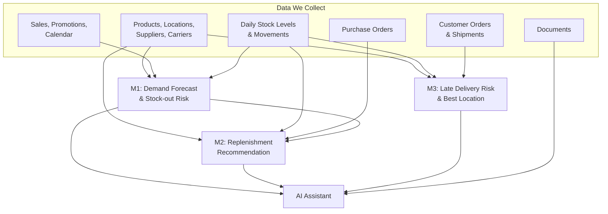

# Inventory & Fulfilment – Dataset Requirements (v0.1)

This document lists the **data we need to collect** for the Inventory & Fulfilment use case. For each dataset, it explains:
* **What each column is**
* **Why we need it**
* **How it helps our models**

We plan to support **3 decisions**. Some parts use machine learning (ML) and some use simple business rules and calculations:
* **M1 – Demand Forecast (ML), with Stock-out Risk calculated from it:** An ML model predicts how many units of each product will sell at each location. We then compare the predicted sales with the stock we have and the stock coming in. If stock would run out, the product is flagged as a stock-out risk. This step is a calculation, not a separate model.
* **M2 – Replenishment Recommendation (business rules + ML lead-time prediction):** Suggests how much stock to order, when, and from which supplier. The order quantity is calculated with a simple formula: *predicted demand during delivery time + backup (safety) stock – current and incoming stock*, rounded up to the supplier's minimum order and box size. The only ML part is predicting how many days the supplier will really take to deliver (lead time). A planner must approve every suggestion.
* **M3 – Late Delivery Risk (ML), plus Best Location ranking:** An ML model predicts the chance that a customer order will be delivered late. A ranking step then scores each possible warehouse or store on stock available, shipping cost, and late risk, and suggests the best one to ship from.

**Build order:** M1 first (M2 needs its forecast), then M2, then M3. M3 does not depend on M1 or M2.

### Simple Glossary
| Term | Meaning |
| :--- | :--- |
| **SKU** | A unique code for one product (for example, "Blue T-shirt, size M"). |
| **Location / Node** | A place that holds stock: a warehouse (DC), a store, or a partner warehouse (3PL). |
| **DC** | Distribution Centre – a large warehouse that supplies stores and ships online orders. |
| **Stock-out** | When a product has zero stock available to sell. |
| **On-hand stock** | Units physically sitting at a location. |
| **Available stock** | On-hand stock minus units already reserved for other orders. |
| **In-transit stock** | Units that are on the way to a location but not yet arrived. |
| **PO (Purchase Order)** | An order we send to a supplier to buy stock. |
| **Lead time** | Number of days between placing a PO and receiving the goods. |
| **MOQ** | Minimum Order Quantity – the smallest amount a supplier will accept. |
| **Structured data (CSV)** | Data in fixed rows and columns, like a spreadsheet. |
| **Semi-structured data (JSON)** | Data with labels and nested lists, like one order holding many items. |
| **Bronze / Silver layer** | Bronze = raw data as received. Silver = cleaned, organised data. |

---

## Data Formats at a Glance

| Format | Datasets |
| :--- | :--- |
| **CSV (structured)** | Products, Locations, Suppliers, Carriers, Calendar, Daily Stock Levels, Daily Sales, Stock Movements, Stock Transfers |
| **JSON (semi-structured)** | Promotions, Purchase Orders, Customer Orders, Shipments & Tracking |
| **PDF (unstructured)** | Contracts, procedures (SOPs), carrier guides |

---

## 1. Datasets

### 1.1 Products (`products.csv`)
* **Format:** Structured (CSV) – fixed columns, one row per record.
* **Where it comes from:** The company's product master system (for example, an ERP system).
* **What it tells us:** Basic details about every product we sell.

| Column | Data Type | What It Is | Why We Need It / How Models Use It |
| :--- | :---: | :--- | :--- |
| `sku_id` | `VARCHAR` | Unique product code. | Links product data to all other datasets. |
| `product_name` | `VARCHAR` | Product name. | Shown to users in answers. |
| `category` | `VARCHAR` | Product group (for example, Electronics, Clothing). | Products in the same group sell in similar patterns (M1). |
| `brand` | `VARCHAR` | Brand name. | Helps the demand forecast (M1). |
| `abc_class` | `VARCHAR` | Importance class: A = top sellers, B = medium, C = slow sellers. | A-class products get higher priority, so we try harder not to run out of them (M2). |
| `unit_cost` | `DECIMAL` | Price we pay the supplier per unit. | Used to calculate order value (M2). Hidden from users who are not authorised. |
| `unit_price` | `DECIMAL` | Price we sell at. | Price affects how much sells (M1). |
| `case_pack_qty` | `INTEGER` | Units in one box from the supplier. | Order quantities are rounded to full boxes (M2). |
| `weight_kg` | `DECIMAL` | Product weight. | Heavier items cost more to ship (M3). |
| `shelf_life_days` | `INTEGER` | Days before the product expires (empty if it does not expire). | Stops us ordering more than we can sell before expiry (M2). |
| `status` | `VARCHAR` | NEW, ACTIVE, or DISCONTINUED. | We do not re-order discontinued products (M2). |
| `launch_date` | `DATE` | Date the product was first sold. | New products have little history, so the forecast handles them differently (M1). |

---

### 1.2 Locations (`locations.csv`)
* **Format:** Structured (CSV) – fixed columns, one row per record.
* **Where it comes from:** Warehouse / store master list.
* **What it tells us:** All places that hold stock or ship orders.

| Column | Data Type | What It Is | Why We Need It / How Models Use It |
| :--- | :---: | :--- | :--- |
| `location_id` | `VARCHAR` | Unique location code. | Links location to stock, sales, and orders. |
| `location_type` | `VARCHAR` | DC, STORE, or 3PL. | Tells which locations can ship online orders (M3). |
| `region` | `VARCHAR` | Area (for example, North, South). | Demand differs by region (M1). Users only see their own region. |
| `postal_code`, `latitude`, `longitude` | `VARCHAR` / `FLOAT` | Address and map position. | Used to work out distance to the customer (M3). |
| `parent_dc_id` | `VARCHAR` | The DC that supplies this store. | Tells where store stock comes from (M2). |
| `storage_capacity` | `INTEGER` | Maximum units the location can hold. | We do not order more than fits (M2). |
| `daily_order_capacity` | `INTEGER` | Maximum orders it can pack per day. | A busy location is more likely to ship late (M3). |
| `cutoff_time` | `TIME` | Latest time an order can be placed to ship the same day. | Orders placed after this time may arrive later (M3). |
| `is_active` | `BOOLEAN` | Whether the location is open. | Closed locations are ignored. |

---

### 1.3 Suppliers (`suppliers.csv`)
* **Format:** Structured (CSV) – fixed columns, one row per record.
* **Where it comes from:** Supplier records in the ERP / procurement system.
* **What it tells us:** Who we buy from and on what terms.

| Column | Data Type | What It Is | Why We Need It / How Models Use It |
| :--- | :---: | :--- | :--- |
| `supplier_id` | `VARCHAR` | Unique supplier code. | Links suppliers to purchase orders. |
| `supplier_name` | `VARCHAR` | Supplier name. | Shown to users. |
| `country` | `VARCHAR` | Supplier country. | Overseas suppliers usually take longer to deliver (M2). |
| `promised_lead_time_days` | `INTEGER` | Delivery time the supplier promises. | We compare promised vs. actual delivery time to see how reliable the supplier is (M2). |
| `sku_id` | `VARCHAR` | Products this supplier sells to us. | Tells which suppliers can supply each product. |
| `moq` | `INTEGER` | Minimum order quantity. | Orders must be at least this size (M2). |
| `contract_unit_cost` | `DECIMAL` | Agreed buying price. | Used to pick the best supplier (M2). Hidden from unauthorised users. |
| `is_preferred` | `BOOLEAN` | Whether this is our main supplier. | Preferred suppliers are chosen first (M2). |
| `is_active` | `BOOLEAN` | Whether we still buy from this supplier. | Inactive suppliers are ignored. |

---

### 1.4 Carriers (`carriers.csv`)
* **Format:** Structured (CSV) – fixed columns, one row per record.
* **Where it comes from:** Transport / shipping system.
* **What it tells us:** Delivery companies we use.

| Column | Data Type | What It Is | Why We Need It / How Models Use It |
| :--- | :---: | :--- | :--- |
| `carrier_id` | `VARCHAR` | Unique carrier code. | Links carriers to shipments. |
| `carrier_name` | `VARCHAR` | Carrier name. | Shown to users. |
| `service_level` | `VARCHAR` | SAME_DAY, NEXT_DAY, or STANDARD. | Faster services have different on-time rates (M3). |
| `promised_transit_days` | `INTEGER` | Days the carrier promises for delivery. | Starting point for predicting late delivery (M3). |
| `base_rate` | `DECIMAL` | Shipping price. | Used to compare shipping cost between locations (M3). |

---

### 1.5 Daily Stock Levels (`inventory_snapshots.csv`)
* **Format:** Structured (CSV) – fixed columns, one row per record.
* **Where it comes from:** Warehouse and store stock systems.
* **What it tells us:** How much stock each location has for each product at the end of each day.

| Column | Data Type | What It Is | Why We Need It / How Models Use It |
| :--- | :---: | :--- | :--- |
| `snapshot_date` | `DATE` | Date of the stock count. | Lets us see stock levels over time. |
| `sku_id`, `location_id` | `VARCHAR` | Product and location. | Links to product and location details. |
| `on_hand_qty` | `INTEGER` | Units physically present. | Main input to check if we will run out (M1, M2). |
| `reserved_qty` | `INTEGER` | Units already promised to orders. | Subtracted to get available stock. |
| `available_qty` | `INTEGER` | Units free to sell (on-hand minus reserved). | Tells if a location can fulfil an order (M3). |
| `in_transit_qty` | `INTEGER` | Units on the way. | Counted as coming stock before we order more (M2). |
| `damaged_qty` | `INTEGER` | Units that cannot be sold. | Not counted as available. |
| `safety_stock_qty` | `INTEGER` | Current backup stock level (set by today's rules). | Compared with the model's suggestion (M2). |
| `is_stockout` | `BOOLEAN` | TRUE if no stock is available. | Shows when we ran out. Sales on these days are lower than real demand, so the model must take this into account (M1). |

---

### 1.6 Stock Movements (`inventory_movements.csv`)
* **Format:** Structured (CSV) – fixed columns, one row per record.
* **Where it comes from:** Warehouse transaction log.
* **What it tells us:** Every time stock goes in or out.

| Column | Data Type | What It Is | Why We Need It / How Models Use It |
| :--- | :---: | :--- | :--- |
| `movement_id` | `VARCHAR` | Unique record ID. | |
| `sku_id`, `location_id` | `VARCHAR` | Product and location. | |
| `movement_type` | `VARCHAR` | RECEIPT, SALE, TRANSFER_IN, TRANSFER_OUT, RETURN, ADJUSTMENT, WRITE_OFF. | Helps check that daily stock levels add up correctly. Shows losses and returns. |
| `quantity` | `INTEGER` | Units moved (+ in, – out). | |
| `reference_id` | `VARCHAR` | Related PO or order number. | Connects goods received to purchase orders, so we can measure actual delivery time (M2). |
| `reason_code` | `VARCHAR` | Reason for adjustment (DAMAGE, THEFT, COUNT_CORRECTION). | Measures stock loss. |
| `timestamp` | `TIMESTAMP` | When it happened. | |

---

### 1.7 Daily Sales (`sales_demand.csv`)
* **Format:** Structured (CSV) – fixed columns, one row per record.
* **Where it comes from:** Store tills (POS) and online store.
* **What it tells us:** How many units of each product sold at each location every day.

| Column | Data Type | What It Is | Why We Need It / How Models Use It |
| :--- | :---: | :--- | :--- |
| `sales_date` | `DATE` | Day of sale. | |
| `sku_id`, `location_id` | `VARCHAR` | Product and location. | |
| `channel` | `VARCHAR` | IN_STORE, WEB, or APP. | Shows how much demand is online vs. in store. |
| `units_sold` | `INTEGER` | Units sold. | **Main value M1 learns to predict.** |
| `sales_amount` | `DECIMAL` | Money received. | Used to measure lost sales from stock-outs. |
| `avg_selling_price` | `DECIMAL` | Average price paid. | Lower prices usually increase sales (M1). |
| `units_returned` | `INTEGER` | Units returned by customers. | Adjusts true demand. |

---

### 1.8 Promotions & Calendar (`promotions.json`, `calendar.csv`)
* **Format:** Promotions = JSON (one promotion can cover a list of products and regions). Calendar = CSV.
* **Where it comes from:** Marketing / pricing team and company calendar.
* **What it tells us:** Special offers and important dates that change sales.

| Column | Data Type | What It Is | Why We Need It / How Models Use It |
| :--- | :---: | :--- | :--- |
| `promo_id` | `VARCHAR` | Unique promotion ID. | |
| `sku_id` / `category`, `region` | `VARCHAR` | Products and regions on offer. | |
| `promo_type` | `VARCHAR` | PRICE_CUT, BUY_ONE_GET_ONE, etc. | **Promotions strongly increase sales** (M1). |
| `discount_pct` | `INTEGER` | Discount size (%). | Bigger discounts usually mean more sales (M1). |
| `start_date`, `end_date` | `DATE` | Promotion period. | Lets the forecast plan ahead for known promotions. |
| `date` | `DATE` | Calendar day. | |
| `is_holiday`, `holiday_name` | `BOOLEAN` / `VARCHAR` | Public holiday. | Holidays change sales and can delay deliveries. |
| `week`, `month`, `season` | `INTEGER` / `VARCHAR` | Calendar details. | Captures weekly and seasonal patterns. |
| `is_peak_period` | `BOOLEAN` | Busy periods like Black Friday or festive season. | Higher chance of late delivery (M3). |

---

### 1.9 Purchase Orders (`purchase_orders.json`)
* **Format:** Semi-structured (JSON) – has nested data (one PO has a list of products).
* **Where it comes from:** ERP / procurement system.
* **What it tells us:** Stock we ordered from suppliers and when it arrived.

| Column | Data Type | What It Is | Why We Need It / How Models Use It |
| :--- | :---: | :--- | :--- |
| `po_id` | `VARCHAR` | Purchase order number. | |
| `supplier_id` | `VARCHAR` | Supplier. | |
| `destination_location_id` | `VARCHAR` | Where the goods are delivered. | |
| `sku_id` | `VARCHAR` | Product ordered. | |
| `ordered_qty` | `INTEGER` | Units ordered. | |
| `received_qty` | `INTEGER` | Units actually received. | Shows if suppliers deliver the full quantity (M2). |
| `order_date` | `DATE` | Date the PO was placed. | Start of lead time. |
| `expected_delivery_date` | `DATE` | Date the supplier promised. | |
| `actual_delivery_date` | `DATE` | Date it really arrived (empty if not yet arrived). | **Actual lead time = actual delivery date minus order date.** This is what M2 learns from. |
| `status` | `VARCHAR` | OPEN, PARTIAL, RECEIVED, CANCELLED. | Open POs count as stock that is coming (M2). |
| `unit_cost` | `DECIMAL` | Price per unit. | Order value; large orders need extra approval. |

---

### 1.10 Customer Orders (`customer_orders.json`)
* **Format:** Semi-structured (JSON) – has nested data (one order has a list of items).
* **Where it comes from:** Online order system.
* **What it tells us:** Online orders that customers placed and need delivered.

| Column | Data Type | What It Is | Why We Need It / How Models Use It |
| :--- | :---: | :--- | :--- |
| `order_id` | `VARCHAR` | Unique order number. | M3 makes one prediction per order. |
| `customer_id` | `VARCHAR` | Customer code. | Not used by models. |
| `customer_name`, `address`, `phone` | `VARCHAR` | **Personal data.** | **Hidden (masked)** and never used by models. |
| `delivery_postal_code`, `delivery_region` | `VARCHAR` | Delivery area. | Distance from location to customer (M3). |
| `order_timestamp` | `TIMESTAMP` | When the order was placed. | Late-night or weekend orders may ship later (M3). |
| `promised_delivery_date` | `DATE` | Date promised to the customer. | Used to decide if the order was late. |
| `service_level` | `VARCHAR` | SAME_DAY, NEXT_DAY, STANDARD. | Faster promises are harder to meet (M3). |
| `fulfilled_from_location_id` | `VARCHAR` | Location that shipped the order. | Past choices help learn the best location (M3). |
| `sku_id`, `qty` | `VARCHAR` / `INTEGER` | Items in the order. | Orders with many items are harder to pack on time. |
| `order_status` | `VARCHAR` | CREATED, PACKED, SHIPPED, DELIVERED, CANCELLED. | Orders not yet delivered are checked daily (M3). |
| `is_split_shipment` | `BOOLEAN` | TRUE if shipped from more than one location. | Costs more and may arrive late. |

---

### 1.11 Shipments & Tracking (`shipments.json`)
* **Format:** Semi-structured (JSON) – has nested data (one shipment has a list of tracking events).
* **Where it comes from:** Shipping system and carrier tracking updates.
* **What it tells us:** When orders were shipped and delivered.

| Column | Data Type | What It Is | Why We Need It / How Models Use It |
| :--- | :---: | :--- | :--- |
| `shipment_id` | `VARCHAR` | Unique shipment ID. | |
| `order_id` | `VARCHAR` | Related customer order. | |
| `origin_location_id` | `VARCHAR` | Shipped from. | |
| `carrier_id`, `service_level` | `VARCHAR` | Carrier used. | Some carriers are late more often (M3). |
| `ship_timestamp` | `TIMESTAMP` | When it left. | Time taken to pack and ship. |
| `delivered_timestamp` | `TIMESTAMP` | When it arrived. | **Late = delivered after promised date.** This is what M3 learns to predict. |
| `shipping_cost` | `DECIMAL` | Cost of delivery. | Compares cost between locations (M3). |
| `event_type` | `VARCHAR` | PICKED_UP, IN_TRANSIT, DELAYED, DELIVERED. | Tracking updates. |
| `delay_note` | `VARCHAR` | Carrier's text note (for example, "weather delay"). | AI groups these into delay reasons (weather, capacity, wrong address). |

---

### 1.12 Stock Transfers (`transfers.csv`) – *Optional*
* **Format:** Structured (CSV) – fixed columns, one row per record.
* **What it tells us:** Stock moved between locations (for example, DC to store).

| Column | What It Is | Why We Need It |
| :--- | :--- | :--- |
| `transfer_id`, `from_location_id`, `to_location_id`, `sku_id`, `qty`, `shipped_date`, `received_date`, `status` | Stock moved between our own locations. | Counted as incoming stock (M2). Can later be used to suggest moving stock between stores. |

---

### 1.13 Documents (PDF files)
* **Format:** Unstructured (PDF) – plain documents, no columns.
* **What they are:** Supplier contracts, warehouse procedures (SOPs), and carrier service guides.
* **Why we need them:** So the AI assistant can answer questions like *"What is the penalty if supplier X delivers late?"* or *"How do we handle damaged deliveries?"*, and show which document and page the answer came from.

| Information | What It Is |
| :--- | :--- |
| `file_name` | Name of the document. |
| `doc_type` | CONTRACT, SOP, or CARRIER_GUIDE. |
| `supplier_id` / `carrier_id` | Who the document is about. |
| `effective_date` | Date from which the document is valid. |

---

## 2. Model Outputs (data we create, not collect)

| Output Table | What It Contains |
| :--- | :--- |
| `DEMAND_FORECAST` | Predicted daily sales per product and location. |
| `STOCKOUT_RISK` | Chance of running out, and the expected date. |
| `REPLENISHMENT_RECOMMENDATION` | Suggested order quantity, supplier, order-by date, and reason. |
| `ORDER_LATE_RISK` | Chance each order will be late, and the best location to ship from. |
| `APPROVAL_AUDIT` | Who approved or rejected each suggestion, and when. |

---

## 3. Data Quality Checks

Before data is used, we check that:
1. **No duplicates or blanks** in ID columns (product, location, order, PO, etc.).
2. **Links are valid**, for example every sale has a product and location that exists.
3. **Values make sense:**
   * Quantities are not negative.
   * Delivery dates are not before order dates.
   * `abc_class` is only A, B, or C.
4. **Stock adds up:** Yesterday's stock + received – sold ± other movements = today's stock.
5. **Data is fresh:** Stock and orders are updated at least once a day.

---

## 4. How the Data Feeds the 3 Models

---

## 5. What to Build First

| Priority | Datasets |
| :--- | :--- |
| **Must have** | Products, Locations, Suppliers, Daily Stock Levels, Daily Sales, Calendar, Purchase Orders |
| **Next** | Customer Orders, Shipments, Carriers, Promotions |
| **Later** | Stock Movements, Stock Transfers, Documents |
