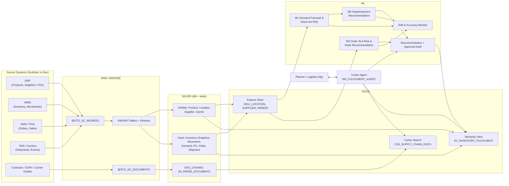

# Design Document: Inventory & Fulfilment Usecase

---

## 1. Document Information

| Attribute | Details |
| :--- | :--- |
| **Agent / Skill / Usecase Name** | Inventory & Fulfilment Intelligence Agent (`INV_FULFILMENT_AGENT`) |
| **Use Case** | Predict stock-outs and late deliveries, recommend replenishment and fulfilment-node decisions for human approval, and answer natural-language inventory questions. |
| **Document Version** | 0.1 (Draft) |
| **Document Status** | Draft |
| **Date** | 2026-11-02 |
| **Authors** | Jaya Shukla |
| **Reviewers** |  |

---

## 2. Purpose and Scope

### 2.1 Business Problem
Retail supply-chain teams make recurring inventory and fulfilment decisions using spreadsheets, static min/max rules, and reports that run after the fact. Typical pain points are:
- **Stock-outs** on fast-moving SKUs cause lost sales, while **overstock** on slow movers ties up working capital and leads to markdowns.
- **Static reorder points** ignore seasonality, promotions, and how reliable each supplier's lead time actually is.
- **Fulfilment node selection** (DC vs. store vs. 3PL) is rule-based, so some orders ship from the wrong node, cost more to ship, and arrive late (SLA breach).
- Planners have to pull data from WMS, OMS, ERP, and carrier portals to answer simple questions like *"Which SKUs in the North region will stock out next week?"*

### 2.2 Objectives
Targets are and should be baselined during Discovery:
1. Improve SKU-location **demand forecast accuracy** over the current naive / moving-average baseline.
2. Cut **stock-out rate** on A-class SKUs.
3. Raise **On-Time-In-Full (OTIF)** delivery.
4. Cut the time planners spend answering ad-hoc inventory questions through the conversational agent.
5. Require **100% human approval** for every purchase order or transfer recommendation before it is activated.

### 2.3 Scope Definition
**In-Scope:**
- **Decision 1 — Demand Forecast (ML) with calculated Stock-out Risk:** an ML model forecasts daily SKU × location demand. Stock-out risk is then *calculated* by comparing the forecast with available + in-transit stock and open POs. No separate model is needed.
- **Decision 2 — Replenishment Recommendation (rules engine + ML lead-time prediction):** suggested order quantity, timing, and supplier per SKU × location. Quantity is rule-based: *forecast demand over lead time + safety stock – (on-hand + in-transit + open POs)*, rounded to MOQ and case pack. ML only predicts the supplier's actual lead time. Planners approve each recommendation.
- **Decision 3 — Late-Delivery Risk (ML) + Best Fulfilment Node ranking:** an ML classifier predicts the probability each open order misses its SLA. A ranking step then scores candidate nodes on availability, shipping cost, and late risk, and recommends the best node.
- **Build order:** Decision 1 → Decision 2 (depends on the M1 forecast) → Decision 3 (independent).
- **Conversational agent** (Cortex Agent) with:
  - Cortex Analyst over a governed semantic view of inventory, orders, shipments, and forecasts.
  - Cortex Search over unstructured SOPs, supplier contracts/SLAs, and carrier policies.
- Medallion pipeline (RAW → BRONZE → SILVER → GOLD → ML) with dbt and data quality tests, reusing the reference patterns.
- Synthetic data generation for Dev (see the dataset requirements document).

**Out-of-Scope:**

### 2.4 Target Users and Personas
| Persona | Needs |
| :--- | :--- |
| **Inventory / Demand Planner** | Stock-out risk list, replenishment recommendations to approve or reject, forecast explanations |
| **Fulfilment / Logistics Manager** | Orders at risk of SLA breach, node recommendations, carrier performance |
| **Procurement / Buyer** | Supplier lead-time reliability, open PO status, contract terms (via Search) |
| **Store / DC Operations Lead** | Location-level stock position and inbound transfers |
| **Supply Chain Leadership** | KPI questions (OTIF, fill rate, inventory turns, days of supply) |

### 2.5 Expected Business Outcomes
- Fewer lost sales from stock-outs, and less working capital tied up in safety stock.
- Lower expedite and split-shipment costs through better node selection.
- Faster, self-service insight for planners, with less reliance on analysts.
- One governed source of truth for inventory KPIs.

### 2.6 Assumptions, Dependencies, and Constraints
- **Assumptions:**
  - Users access the agent through Snowsight (Snowflake Intelligence / Cortex Agent UI) or Cortex Code CLI.
  - Synthetic data is used in Dev until source-system extracts (ERP, WMS, OMS, TMS) are available.
- **Dependencies:**
  - Platform setup (`setup.sql`): a role, warehouse, and database.
  - Cortex AI functions, Cortex Analyst, Cortex Search, and Cortex Agents enabled in the account and region.
- **Constraints:**
  - All compute stays inside Snowflake.
  - Supplier contract terms are commercially confidential and need role-restricted access.
  - Customer PII in order data (name, address) should be masked or excluded from the agent context.

---

## 3. Core Architectural Principles

- [x] **Security by Design:** RBAC, masking, and row access policies are defined.
- [x] **Least-Privilege Access:** Separate roles for pipeline (`INV_FUL_ENGINEER_RL`), agent consumer (`INV_FUL_ANALYST_RL`), and approver (`INV_FUL_PLANNER_RL`).
- [x] **Data Privacy and Governance:** Customer PII in orders is masked. Supplier cost fields are masked for non-procurement roles.
- [x] **Reusability and Modularity:** Canonical SILVER entities (`PRODUCT_ENTITY`, `LOCATION_ENTITY`, `SUPPLIER_ENTITY`) are reusable across use cases.
- [x] **Configuration over Hardcoding:** Thresholds (service level, risk cut-offs, approval limits) live in `ML.CFG_INV_FUL_PARAMETERS`.
- [x] **Observability and Auditability:** Event table for agent traces, plus audit tables for tracking recommendation, approval, and override.
- [x] **Human-in-the-Loop Controls:** Every replenishment and transfer recommendation needs planner approval. High-value POs (≥ configured limit) need a second approver.

---

## 4. Tools and Technologies

| Component Category | Selected Technology | Purpose & Justification |
| :--- | :--- | :--- |
| **Snowflake Cortex AI** | Cortex Agent (orchestration), Cortex Analyst (semantic view), Cortex Search (SOPs/contracts), `AI_COMPLETE` (recommendation narratives), `AI_CLASSIFY` (delay-reason categorisation of carrier notes) | The Agent routes between structured (Analyst) and unstructured (Search) questions. AI functions add explanations and classify free-text delay reasons. |
| **Machine Learning** | Snowpark ML, Snowflake Feature Store, Model Registry, Snowflake Notebooks. LightGBM / XGBoost. Partitioned (many-model) training for forecasting. | Consistent with reference stack. Partitioned models give per-category/region forecasts at scale. |
| **Compute / Orchestration** | Virtual warehouses (XS ingest/agent, M training), Snowflake Tasks / task graphs, Snowpark stored procedures as agent tools | Native scheduling for daily snapshot → features → scoring → recommendation. |
| **Data Storage / Modeling** | Medallion: RAW stage → BRONZE → SILVER canonical entities → GOLD Feature Store + semantic view → ML outputs | Dynamic tables are optional for near-real-time order/shipment status. |
| **Data Quality** | dbt tests + Snowflake Data Metric Functions (freshness, null count, duplicates) | dbt as the gate; DMFs for continuous monitoring. |
| **External Tools (if any)** | Git | CI/CD. |

---

## 5. Cortex Analyst Design

### 5.1 Supported Business Questions
1. "Which SKUs are at high risk of stock-out in the next 7 days, by region?"
2. "What is the current days-of-supply for category ELECTRONICS at DC_NORTH?"
3. "Show OTIF % by carrier for last month."
4. "Which suppliers have the worst lead-time variance this quarter?"
5. "How many open orders are at risk of missing SLA today, and from which fulfilment node?"
6. "What is the forecast vs. actual demand (WAPE) for top 20 SKUs last 4 weeks?"
7. "List pending replenishment recommendations above $10,000 awaiting approval."
8. "What is inventory turnover and fill rate by store for Q3?"

### 5.2 Semantic Model Definition
- **Database/Schema:** `SUPPLY_CHAIN_INTELLIGENCE_DEV.GOLD` 
- **Semantic View:** `GOLD.SV_INVENTORY_FULFILMENT`
- **Primary Tables/Views:** `PRODUCT_ENTITY`, `LOCATION_ENTITY`, `SUPPLIER_ENTITY`, `CARRIER_ENTITY`, `INVENTORY_SNAPSHOT_FACT`, `SALES_DEMAND_FACT`, `PURCHASE_ORDER_FACT`, `CUSTOMER_ORDER_FACT`, `SHIPMENT_FACT`, `ML.DEMAND_FORECAST`, `ML.REPLENISHMENT_RECOMMENDATION`, `ML.ORDER_SLA_RISK`
- **Key Dimensions:** Date / Week / Month, Product (SKU, category, ABC class), Location (store, DC, region, node type), Supplier, Carrier, Order channel, Recommendation status
- **Key Measures:** On-hand qty, Available-to-promise qty, In-transit qty, Days of supply, Stock-out flag/rate, Fill rate, OTIF %, Lead time (avg, std dev), Forecast qty, WAPE / bias, Inventory value, Turnover, Recommended order qty/value, SLA-breach probability

---

## 6. Cortex Search Design

### 6.1 Search Use Cases
- "What is the SLA penalty clause for supplier SUP_0042?"
- "What is the SOP for handling a damaged inbound shipment?"
- "What is carrier X's cut-off time for same-day dispatch?"

### 6.2 Source Documents & Data
- **Data Sources:** Supplier contracts / SLA documents (PDF), warehouse SOPs (PDF/DOCX), carrier service guides (PDF), free-text delay notes from shipment events.
- **Ingestion Pipeline:** Files land on `@RAW.STG_SC_DOCUMENTS`, are parsed with `AI_PARSE_DOCUMENT` (layout mode) into `SILVER.DOC_CHUNKS`, and are refreshed by a task.

### 6.3 Refresh Strategy
`TARGET_LAG = '1 day'` on the search service source table.

---

## 7. Functions and Extensions

| Function/Tool Name | Purpose | Input Parameters | Output/Return | Execution Context / Security |
| :--- | :--- | :--- | :--- | :--- |
| `GET_STOCKOUT_RISK` | Top-N SKU×location by stock-out probability | `region VARCHAR, horizon_days INT, top_n INT` | TABLE | SQL UDTF, caller's rights, RAP enforced |
| `GET_REPLENISHMENT_RECS` | Pending recommendations with rationale | `location_id VARCHAR, status VARCHAR` | TABLE | SQL UDTF, caller's rights |
| `EXPLAIN_RECOMMENDATION` | Narrative explanation (drivers, SHAP top features) via `AI_COMPLETE` | `recommendation_id VARCHAR` | VARCHAR | Snowpark proc, owner's rights, read-only |
| `SUBMIT_APPROVAL_DECISION` | Planner approves/rejects/overrides a recommendation | `recommendation_id, decision, override_qty, comment` | VARIANT (status) | Stored proc, **only `INV_FUL_PLANNER_RL`**, writes audit row. The agent must ask for explicit user confirmation before calling it. |
| `GET_ORDER_SLA_RISK` | Open orders at risk + recommended node | `as_of_date DATE, min_risk FLOAT` | TABLE | SQL UDTF, PII columns masked |

**Error Handling & Dependencies:** Tools return structured errors (`{status, message}`). The agent reports failures in plain language and never retries a write tool automatically.

---

## 8. Overall Architecture

### 8.1 Logical Architecture
1. **Ingestion (RAW/BRONZE):** JSON/CSV extracts land on an internal stage and are loaded with `COPY INTO` into `VARIANT` tables with change tracking.
2. **Canonical Modeling (SILVER, dbt):** Entities (Product, Location, Supplier, Carrier) and facts (Inventory Snapshot, Inventory Movement, Sales Demand, Purchase Order, Customer Order, Shipment), gated by dbt tests.
3. **Feature Layer (GOLD):** Feature Store entities `SKU_LOCATION`, `SUPPLIER`, `ORDER`. Feature views for demand history and seasonality, inventory position, supplier reliability, and fulfilment/carrier performance. Plus semantic view `SV_INVENTORY_FULFILMENT` and the Cortex Search service.
4. **ML (ML schema):** Three models trained in Notebooks, registered in the Model Registry, and scored daily by tasks into output tables.
5. **Decision Layer:** Recommendations go to the approval workflow (`ML.REPLENISHMENT_RECOMMENDATION` + `ML.APPROVAL_AUDIT`).
6. **Agent Layer:** A Cortex Agent combines Analyst, Search, and custom tools.

### 8.2 Data and Control Flow
1. Data extracts land in `@RAW.STG_SC_INGRESS`. A task runs `COPY INTO` into BRONZE.
2. dbt builds SILVER and runs tests.
3. Feature views refresh. The scoring task runs Model 1 (forecast + stock-out risk), then Model 2 (replenishment qty), then Model 3 (order SLA risk / node).
4. Recommendations are written with status `PENDING_APPROVAL` and narratives generated with `AI_COMPLETE`.
5. A planner asks the agent, e.g. "Show high-risk SKUs for North", and the agent routes to Analyst or a tool.
6. The planner approves or overrides through `SUBMIT_APPROVAL_DECISION`. An audit row is written.
7. Monitoring tasks compare forecast to actuals and raise alerts or trigger retraining.

### 8.3 Authentication, Authorization, & Integration
- Users authenticate with Snowflake SSO (Snowsight) or OAuth/key-pair (CLI). The agent runs in the user's session role.
- Service role `INV_FUL_ENGINEER_RL` owns pipelines and tasks.

### 8.4 Architecture Diagram

---

## 9. Agent Design

### 9.1 Supported Intents and Tasks
1. **Inventory position Q&A:** stock levels, DOS, turns, fill rate (Analyst).
2. **Risk surfacing:** stock-out risk and SLA-breach risk lists (tools).
3. **Recommendation review:** list, explain, and approve/reject/override replenishment recommendations (tools, HITL).
4. **Supplier & carrier performance:** lead-time reliability, OTIF by carrier (Analyst).
5. **Policy & contract lookup:** SOPs, supplier SLAs, carrier terms (Search).
6. **Root-cause narrative:** "Why is SKU X at risk?" combines forecast drivers, open POs, and supplier delay history (tools + `AI_COMPLETE`).

### 9.2 Prompt and Instruction Strategy
- **System Prompt Outline:** The agent acts as a supply-chain planning assistant. It answers from governed data and documents, always states the as-of date of the data, never invents quantities, and asks for explicit confirmation before any approval action.
- **Context Injection:** Analyst SQL results and Search chunks with metadata are injected by the Cortex Agent orchestration. Glossary and business rules are loaded from the stage-hosted context file.

### 9.3 Tool-Selection Rules
| Question pattern | Tool |
| :--- | :--- |
| Metrics, KPIs, aggregations, trends | Cortex Analyst (`SV_INVENTORY_FULFILMENT`) |
| Policies, contract terms, procedures | Cortex Search (`CSS_SUPPLY_CHAIN_DOCS`) |
| "At risk", "recommend", "should I order" | `GET_STOCKOUT_RISK`, `GET_REPLENISHMENT_RECS`, `GET_ORDER_SLA_RISK` |
| "Why" for a recommendation | `EXPLAIN_RECOMMENDATION` |
| "Approve / reject / change qty" | `SUBMIT_APPROVAL_DECISION` (only after confirmation) |

### 9.4 Context and Conversation Management
Cortex Agent conversations are logged to the event table for audit.

### 9.5 Handling Ambiguity and Exceptions
- Missing location/SKU/timeframe: the agent asks one clarifying question, or defaults to "all locations, last 30 days" and says so.
- No data or no search hits: "I couldn't find data for that". No fabricated answers.
- Off-topic (HR, pricing, etc.): polite decline with a list of supported topics.
- Write intent from a non-planner role: the agent explains that approval rights are needed.

### 9.6 ML Model Suite (supporting the agent)

| Model | Decision | Approach | Label / Target | Baseline | Primary Metric |
| :--- | :--- | :--- | :--- | :--- | :--- |
| **M1 – Demand Forecast (ML) + Stock-out Risk (calculation)** | How much will each SKU×location sell? Which will stock out in the next N days? | **ML:** Partitioned LightGBM regressor (by category × region) with lag, rolling, calendar, promo, and price features. Snowflake built-in `FORECAST` can be the first version. **Calculation:** stock-out risk = projected available (on-hand + in-transit + open POs – forecast) ≤ 0 within horizon. Forecast quantiles (P10/P50/P90) give a probability. | Daily `units_sold` (with stock-out days adjusted) | Seasonal naive / 28-day moving average | WAPE, Bias. Stock-out Recall/Precision |
| **M2 – Replenishment Recommendation (rules engine + ML lead time)** | How much to order, when, and from which supplier? | **Rules:** order qty = forecast over lead time + safety stock (by ABC service level) – inventory position, rounded to MOQ / case pack, capped by capacity, shelf life, and budget. **ML:** LightGBM quantile regressor predicts actual supplier lead time. | Actual lead time days (lead-time model only) | Static min/max rules | Simulated fill rate vs. inventory value. Lead-time MAE |
| **M3 – Late Delivery Risk (ML) + Best Node ranking** | Will this order be late? Which node should fulfil it? | **ML:** LGBMClassifier on order, node, and carrier features. **Ranking:** candidate nodes with enough available stock scored by P(on-time) and shipping cost; best node recommended. The ranking can be added after the classifier is live. | `is_late` (delivered_at > promised_at) | Rule-based nearest node | ROC-AUC, Recall at risk threshold. OTIF uplift |

Only M1's forecast, M2's lead-time prediction, and M3's late-risk classifier are ML models. Stock-out risk, order quantity, and node ranking are rules and calculations. The ML approach is a proposal.

---

## 10. Configuration and Customization

### 10.1 Environment Settings
`DATABASE` (`SUPPLY_CHAIN_INTELLIGENCE_{DEV|QA|PROD}`), `STAGE_DOCS`, `SEMANTIC_VIEW_NAME`, `SEARCH_SERVICE_NAME`, `AGENT_CONTEXT_FILE`.

### 10.2 Customization Parameters (stored in `ML.CFG_INV_FUL_PARAMETERS`)
| Parameter | Description | Default Value | Allowed Values |
| :--- | :--- | :--- | :--- |
| `FORECAST_HORIZON_DAYS` | Forecast horizon | `28` | `7–90` |
| `TARGET_SERVICE_LEVEL_A/B/C` | Cycle service level per ABC class | `0.98 / 0.95 / 0.90` | `0.80–0.995` |
| `STOCKOUT_RISK_THRESHOLD` | Probability above which a SKU is flagged | `0.60` | `0.30–0.95` |
| `SLA_RISK_THRESHOLD` | Late-delivery probability flag | `0.50` | `0.30–0.95` |
| `PO_SECOND_APPROVAL_LIMIT` | PO value requiring a second approver | `25000` | `> 0` |

---

## 11. Security, Governance, and Guardrails

### 11.1 Access Control (RBAC/ABAC)
| Role | Privileges |
| :--- | :--- |
| `INV_FUL_ENGINEER_RL` | Owns schemas, pipelines, tasks, models |
| `INV_FUL_ANALYST_RL` | SELECT on GOLD/ML outputs, USAGE on agent, semantic view, search |
| `INV_FUL_PLANNER_RL` | Inherits ANALYST + USAGE on `SUBMIT_APPROVAL_DECISION` |
| `INV_FUL_PROCUREMENT_RL` | Inherits ANALYST + unmasked supplier cost/contract data |

---

## 12. Testing and Validation

### 12.1 Testing Strategy
- [ ] **Unit Testing:** dbt tests (unique, not_null, relationships, accepted ranges) and pytest on Snowpark procs.
- [ ] **Functional / Prompt Evaluation:** 50-question golden set (Analyst SQL accuracy) and 25 Search questions (groundedness), scored with LLM-as-judge plus manual review.

---

## 13. Observability and Operations

### 13.1 Monitoring Metrics
- **Usage:** Daily active users, questions per day, approvals per day, override rate.
- **Performance:** Agent latency, tool latency, pipeline duration.
- **Cost:** Warehouse credits, Cortex token/credit consumption.

### 13.2 Dashboards and Alerts
Snowsight dashboard "Inventory & Fulfilment Ops". Alerts:
- dbt test failure or freshness > 26 h

---

## 14. Deployment and Release Management

### 14.1 Environment Strategy
Separate databases `SUPPLY_CHAIN_INTELLIGENCE_DEV / _QA / _PROD` with schemas `RAW, BRONZE, SILVER, GOLD, ML`. Dev uses synthetic data.

### 14.2 CI/CD Pipeline
Git repo, GitHub Actions.

---

## 16. Design Review Checklist

- [ ] **Architecture Compliance**
- [ ] **Security & Guardrail Approval**
- [ ] **Data Governance Approval**
- [ ] **Cost/Performance Validation**
- [ ] **Operational Readiness**

***
