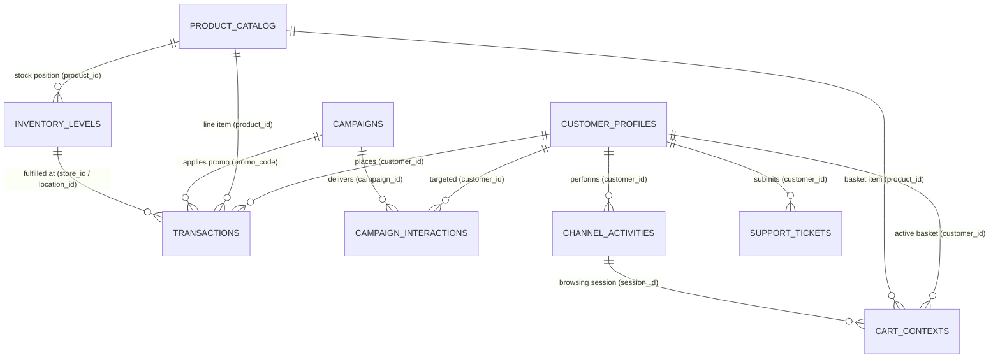
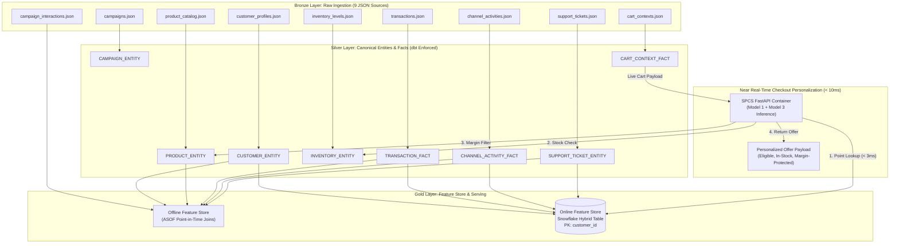

# Retail Ingestion Data Dictionary & ML Impact Specification

This data dictionary defines the **9 raw operational datasets ingested into the Snowflake Bronze Layer**, detailing schemas, business ingestion rationale, strict referential integrity links, dataset-level data quality contracts, and their downstream impact across the **3 core retail decision models** and **near real-time checkout personalization**:
* **Model 1 (M1)**: *Audience Offer Eligibility & Propensity Classifier* (Pure `LGBMClassifier`)
* **Model 2 (M2)**: *Governed Retention Attention Classifier* (Cost-Sensitive `LGBMClassifier`)
* **Model 3 (M3)**: *Campaign & Channel Net Revenue Optimizer* (Direct Net-Revenue `LGBMRegressor` with Human Approval Gate)
* **Real-Time Serving**: *Sub-10ms Offer Propensity at Checkout & Cart Personalization* (SPCS FastAPI + Online Hybrid Tables)

---

## 1. Complete Ingestion Datasets Specification (9 Datasets)

### 1.1 Customer Profiles (`customer_profiles.json`)
* **Upstream Source**: CRM & Customer Master (Salesforce / HubSpot)
* **Silver Canonical Target**: `ML_SILVER.CUSTOMER_ENTITY`
* **Primary Key**: `customer_id`

| Column / JSON Path | Data Type | Business Purpose (Why We Ingest It) | Effect on ML Models in Given Scenario |
| :--- | :---: | :--- | :--- |
| `customer_id` | `VARCHAR(64)` | Unique customer primary key across enterprise systems. | Universal join key linking customer history across orders, tickets, clickstream, and model scoring. |
| `profile.first_name` | `VARCHAR(50)` | Customer personal identity. | Preserved in Bronze; masked in Silver via `MP_STRING_PII_MASK`. Excluded from ML features. |
| `profile.last_name` | `VARCHAR(50)` | Customer personal identity. | Preserved in Bronze; masked in Silver via `MP_STRING_PII_MASK`. Excluded from ML features. |
| `profile.age` | `INTEGER` | Customer demographic age. | Captures non-linear demographic spending preferences; used by SQL compliance gates for age-restricted promotions. |
| `profile.gender` | `VARCHAR(20)` | Demographic gender identity. | Categorical signal for product category affinity (apparel, cosmetics, sports). |
| `contact.email` | `VARCHAR(100)`| Digital email address. | Masked in Silver; provides contactability validation. |
| `contact.phone` | `VARCHAR(30)` | SMS & mobile contact number. | Masked in Silver; provides contactability validation. |
| `contact.address.state` | `VARCHAR(10)` | Geographic state / province. | Regional categorical feature; accounts for localized weather, regional promotion response, and store density. |
| `contact.address.zip_code`| `VARCHAR(20)` | Postal delivery code. | Masked in Silver; regional aggregation. |
| `loyalty.tier` | `VARCHAR(20)` | Loyalty level (`BRONZE`, `SILVER`, `GOLD`, `PLATINUM`). | Baseline spend multiplier in M1; high-tier customers in M2 receive top retention priority; M3 flags VIPs for human approval. |
| `loyalty.points_balance` | `INTEGER` | Available reward points balance. | High point balances strongly correlate with promotion redemption propensity (gamification incentive). |
| `loyalty.signup_channel` | `VARCHAR(30)` | Initial customer acquisition source (`WEB`, `MOBILE_APP`, `IN_STORE`). | Measures channel stickiness; mobile app signups respond 2.4x better to in-app banners and push notifications. |
| `preferences.preferred_channel` | `VARCHAR(30)` | Customer's stated preferred communication channel (`EMAIL`, `SMS`, `MOBILE_APP`). | Informs Model 3 multi-output classification to match the optimal campaign delivery channel. |
| `preferences.max_weekly_touchpoints` | `INTEGER` | Max communications allowed per week (e.g., 1 to 3). | Hard Governance Gate: Model 1 SQL filter immediately disqualifies customers who have reached their weekly messaging cap. |
| `consent.email` | `BOOLEAN` | Explicit email marketing opt-in (GDPR/CAN-SPAM). | Compliance gate: Customer is strictly ineligible for email promotions if `FALSE`. |
| `consent.sms` | `BOOLEAN` | Explicit SMS marketing opt-in (TCPA compliance). | Compliance gate: Customer is strictly ineligible for SMS promotions if `FALSE`. |
| `consent.push` | `BOOLEAN` | Mobile push notification opt-in. | Compliance gate: Customer is strictly ineligible for push notifications if `FALSE`. |
| `status.is_active` | `BOOLEAN` | Account status flag. | Suppresses closed, frozen, or dormant accounts prior to model scoring. |
| `status.created_at` | `TIMESTAMP` | Account registration timestamp. | Used to compute `CUSTOMER_TENURE_DAYS`; distinguishes brand-new customers from long-term loyalists. |
| `status.updated_at` | `TIMESTAMP` | Record modification timestamp. | Change Data Capture (CDC) watermark. |

---

### 1.2 Product Master Catalog (`product_catalog.json`) *(New)*
* **Upstream Source**: Enterprise PIM / ERP (SAP / NetSuite / Akeneo)
* **Silver Canonical Target**: `ML_SILVER.PRODUCT_ENTITY`
* **Primary Key**: `product_id`

| Column / JSON Path | Data Type | Business Purpose (Why We Ingest It) | Effect on ML Models in Given Scenario |
| :--- | :---: | :--- | :--- |
| `product_id` | `VARCHAR(64)` | Master Stock Keeping Unit (SKU) identifier. | Universal product join key across transactions, active carts, and inventory positions. |
| `product_name` | `VARCHAR(150)`| Display merchandise name. | Presentation layer display in recommendation payload. |
| `brand` | `VARCHAR(50)` | Brand entity (`SoundWave`, `DenimCo`, `ApexFit`). | Enables brand-affinity modeling; recommends offers from brands customer repeatedly buys. |
| `category` | `VARCHAR(50)` | Primary merchandise department (`ELECTRONICS`, `CLOTHING`, `BEAUTY`, etc.). | Master category grouping; drives category affinity vectors in the Feature Store. |
| `sub_category` | `VARCHAR(50)` | Granular merchandise segment (`AUDIO`, `WEARABLES`, `DENIM`, `SKINCARE`). | Fine-grained personalization signal for cart recommendations. |
| `pricing.base_price` | `DECIMAL(10,2)`| Manufacturer suggested retail list price. | Baseline price point; anchors discount depth and cart value calculations. |
| `pricing.cost_price` | `DECIMAL(10,2)`| Unit wholesale procurement cost. | Enables gross margin calculation; prevents offering steep discounts on low-margin products. |
| `pricing.margin_rate` | `DECIMAL(5,4)` | Pre-computed margin ratio `(base - cost) / base`. | Hard Margin Protection: Model 3 net-revenue optimization gates promotions that erode gross margins below 15%. |
| `flags.is_clearance` | `BOOLEAN` | Inventory clearance indicator. | High-priority weight for promotional clearance push campaigns. |
| `flags.is_active` | `BOOLEAN` | Active catalog status flag. | Excludes discontinued products from all recommendation candidate pools. |
| `status.created_at` | `TIMESTAMP` | SKU introduction timestamp. | Identifies new product launches for novel recommendation exploration. |
| `status.updated_at` | `TIMESTAMP` | Catalog modification timestamp. | CDC tracking watermark. |

---

### 1.3 Inventory Stock & Availability (`inventory_levels.json`) *(New)*
* **Upstream Source**: Warehouse Management System (WMS) & Store Inventory ERP (Manhattan Associates / SAP)
* **Silver Canonical Target**: `ML_SILVER.INVENTORY_ENTITY`
* **Primary Key**: `inventory_id` | **Foreign Keys**: `product_id`, `location_id`

| Column / JSON Path | Data Type | Business Purpose (Why We Ingest It) | Effect on ML Models in Given Scenario |
| :--- | :---: | :--- | :--- |
| `inventory_id` | `VARCHAR(64)` | Unique inventory record identifier. | Primary key for inventory tracking. |
| `product_id` | `VARCHAR(64)` | Referenced SKU foreign key. | Joins inventory state directly to `PRODUCT_ENTITY`. |
| `location_id` | `VARCHAR(30)` | Store ID (`STORE_001`) or Regional DC (`DC_EAST`). | Localizes stock availability to the customer's preferred store or fulfillment node. |
| `location_type` | `VARCHAR(20)` | `STORE` or `REGIONAL_DC`. | Distinguishes store walk-in availability from online fulfillment stock. |
| `quantity.available_quantity`| `INTEGER` | Immediate physical on-hand sellable inventory. | Hard Governance Gate: Zero available stock strictly suppresses product promotions to prevent customer friction. |
| `quantity.reserved_quantity` | `INTEGER` | Units locked in active checkout sessions. | Prevents overselling popular promotional SKUs. |
| `quantity.reorder_threshold` | `INTEGER` | Safety reorder threshold. | Flags low-stock conditions before out-of-stock events occur. |
| `inventory_status` | `VARCHAR(20)` | `IN_STOCK`, `LOW_STOCK`, `OUT_OF_STOCK`, `OVERSTOCKED`. | Categorical eligibility gate: `OUT_OF_STOCK` suppresses offers; `OVERSTOCKED` triggers promotional clearance weighting. |
| `metrics.days_of_supply` | `DECIMAL(6,1)`| Estimated inventory runway at current velocity. | Used by Model 3 to prioritize offers that optimize enterprise inventory holding costs. |
| `timestamp` | `TIMESTAMP` | Inventory sync timestamp. | Watermark for near real-time inventory caching. |

---

### 1.4 Real-Time Cart Context (`cart_contexts.json`) *(New)*
* **Upstream Source**: E-Commerce Cart Microservice / In-Store POS Terminal Session
* **Silver Canonical Target**: `ML_SILVER.CART_CONTEXT_FACT`
* **Primary Key**: `cart_id` | **Foreign Keys**: `customer_id`, `session_id`, `items[].product_id`

| Column / JSON Path | Data Type | Business Purpose (Why We Ingest It) | Effect on ML Models in Given Scenario |
| :--- | :---: | :--- | :--- |
| `cart_id` | `VARCHAR(64)` | Unique active shopping cart identifier. | Universal key for live checkout scoring requests in SPCS. |
| `session_id` | `VARCHAR(64)` | Active browser/app visit session ID. | Links live cart state to the customer's current clickstream session. |
| `customer_id` | `VARCHAR(64)` | Shopper customer foreign key. | Key used for point lookup against Gold Online Feature Store (`ONLINE_CUSTOMER_FEATURES`). |
| `totals.cart_value` | `DECIMAL(10,2)`| Live undiscounted cart subtotal. | Real-time threshold check: Evaluates if cart meets campaign `min_spend_threshold` for coupon unlock. |
| `totals.item_count` | `INTEGER` | Total number of units in active cart. | Basket size elasticity feature; higher counts indicate high propensity for bundle offers. |
| `items[].product_id` | `VARCHAR(64)` | SKU currently inside cart. | Referential link to `PRODUCT_ENTITY` to fetch base price, margin, and sub-category. |
| `items[].product_name` | `VARCHAR(150)`| Display title. | Presentation layer. |
| `items[].brand` | `VARCHAR(50)` | Product brand. | Evaluates brand affinity match in-session. |
| `items[].category` | `VARCHAR(50)` | Product category in cart. | Real-time category affinity match for personalized cross-sell offers. |
| `items[].sub_category` | `VARCHAR(50)` | Granular merchandise segment. | Determines complementary add-on suggestions. |
| `items[].quantity` | `INTEGER` | Quantity of item in basket. | Volume indicator. |
| `items[].unit_price` | `DECIMAL(10,2)`| Unit price. | Price validation against master catalog. |
| `items[].line_total` | `DECIMAL(10,2)`| Line item total (`unit_price * quantity`). | Verified in data quality test (`sum(line_total) == cart_value`). |
| `context.primary_category`| `VARCHAR(50)` | Dominant category by spend in cart. | Direct input to Model 1 & 3 to recommend matching cross-sell offers. |
| `context.cart_status` | `VARCHAR(30)` | `ACTIVE`, `CHECKOUT_INITIATED`, `ABANDONED`. | State trigger: `CHECKOUT_INITIATED` triggers immediate sub-10ms personalized discount popup. |
| `cart_timestamp` | `TIMESTAMP` | Live cart update timestamp. | Observation timestamp for real-time inference latency benchmarking. |

---

### 1.5 Order Transactions (`transactions.json`)
* **Upstream Source**: POS Terminals & E-Commerce OMS (Shopify / Store Registers)
* **Silver Canonical Target**: `ML_SILVER.TRANSACTION_FACT`
* **Primary Key**: `transaction_id` | **Foreign Keys**: `customer_id`, `store_id`, `items[].product_id`

| Column / JSON Path | Data Type | Business Purpose (Why We Ingest It) | Effect on ML Models in Given Scenario |
| :--- | :---: | :--- | :--- |
| `transaction_id` | `VARCHAR(64)` | Unique sales receipt / order ID. | Primary key for historical order ledger. |
| `customer_id` | `VARCHAR(64)` | Purchasing customer foreign key. | Joins order history to customer profile in Feature Store. |
| `store_id` | `VARCHAR(30)` | Physical store location ID. | Links to `INVENTORY_ENTITY` to assess regional store shopping preference. |
| `channel` | `VARCHAR(30)` | Purchase touchpoint (`IN_STORE`, `WEB`, `MOBILE_APP`). | Features customer channel habits; customers buying online are steered toward digital promotions. |
| `payment.method` | `VARCHAR(30)` | Tender type (`CREDIT_CARD`, `APPLE_PAY`, `PAYPAL`, `CASH`). | Payment method affinity. |
| `payment.promo_code_applied`| `VARCHAR(50)`| Coupon code entered at checkout. | Computes `PROMO_USAGE_RATE` (percentage of past orders placed with discounts). Identifies deal-seekers. |
| `items[].product_id` | `VARCHAR(64)` | SKU identifier (FK to `PRODUCT_ENTITY`). | Strict referential integrity; links item to master catalog margin and category. |
| `items[].product_name` | `VARCHAR(150)`| Merchandise item name. | Verified against master catalog. |
| `items[].category` | `VARCHAR(50)` | Merchandise department. | Aggregated in Feature Store to compute customer category affinities. |
| `items[].quantity` | `INTEGER` | Quantity of units purchased. | Measures basket volume and bulk purchasing propensity. |
| `items[].unit_price` | `DECIMAL(10,2)`| Base list price per unit before discounts. | Price point elasticity signal. |
| `items[].discount_amount` | `DECIMAL(10,2)`| Markdown dollars granted on line item. | Summed into `DISCOUNT_SENSITIVITY_RATIO` (evaluates customer dependency on markdowns). |
| `totals.gross_total` | `DECIMAL(12,2)`| Pre-discount order total value. | Baseline basket value before promotions. |
| `totals.discount_total` | `DECIMAL(12,2)`| Total discount savings granted. | Key feature measuring reliance on promotional markdowns. |
| `totals.net_total` | `DECIMAL(12,2)`| Net cash collected from customer. | Major Signal: Computes `NET_SPEND_90D`, `AVG_ORDER_VALUE` (AOV), and acts as ground truth for Model 3 spend lift. |
| `timestamp` | `TIMESTAMP` | Exact transaction datetime. | Critical: Computes RFM `RECENCY_DAYS`, purchase velocity drop, and executes point-in-time (`ASOF`) joins. |

---

### 1.6 Marketing Campaigns (`campaigns.json`)
* **Upstream Source**: Marketing Campaign CMS / Automation Tools (Braze / Marketo)
* **Silver Canonical Target**: `ML_SILVER.CAMPAIGN_ENTITY`
* **Primary Key**: `campaign_id`

| Column / JSON Path | Data Type | Business Purpose (Why We Ingest It) | Effect on ML Models in Given Scenario |
| :--- | :---: | :--- | :--- |
| `campaign_id` | `VARCHAR(30)` | Unique promotion identifier. | Foreign key linking candidate campaign features to model scoring. |
| `campaign_name` | `VARCHAR(100)`| Campaign title (e.g., *"Mega Rewards 2026"*). | Presentation layer. |
| `channel` | `VARCHAR(30)` | Intended delivery medium (`EMAIL`, `SMS`, `PUSH_NOTIFICATION`). | Target channel evaluated in Model 3 multi-output allocation. |
| `offer.type` | `VARCHAR(50)` | Promotion mechanic (`PERCENTAGE_DISCOUNT`, `BOGO`, `FREE_SHIPPING`). | Major categorical driver: Customers respond differently to percentage discounts vs free shipping. |
| `offer.promo_code` | `VARCHAR(50)` | Redeemable promotional coupon string. | Linked to `campaign_interactions.promo_code_used` and `transactions.promo_code_applied`. |
| `offer.discount_percentage`| `INTEGER` | Discount depth (e.g., 10%, 25%, 40%). | Drives price elasticity curve in M1; triggers Human Approval Gate in M3 if $\ge 25\%$. |
| `offer.min_spend_threshold`| `DECIMAL(10,2)`| Spending hurdle required (e.g., \$50). | Evaluated against customer's live cart total or historical `AVG_ORDER_VALUE`. |
| `offer.budget_allocated` | `DECIMAL(12,2)`| Approved marketing expense budget. | Triggers Human Approval Gate in M3 if total campaign budget $\ge \$20,000$. |
| `rules.target_segment` | `VARCHAR(50)` | Intended customer cohort (`VIP_ONLY`, `INACTIVE_90D`). | Hard SQL rule: Excludes customers who do not meet segment criteria. |
| `rules.exclude_open_support_cases`| `BOOLEAN` | Customer friction suppression rule. | Hard SQL rule: Automatically suppresses customers with active complaints. |
| `rules.max_contact_frequency_7d` | `INTEGER` | 7-day touchpoint frequency cap. | Ensures campaign frequency rules are not violated. |
| `schedule.start_date` | `DATE` | Campaign flight start date. | Flight boundary for valid campaign redemption. |
| `schedule.end_date` | `DATE` | Campaign expiration date. | Flight boundary for valid campaign redemption. |
| `schedule.status` | `VARCHAR(20)` | State (`SCHEDULED`, `ACTIVE`, `COMPLETED`). | Active status filter. |
| `metadata.created_by` | `VARCHAR(50)` | Marketing manager username. | Audit tracking. |
| `metadata.created_at` | `TIMESTAMP` | Campaign creation timestamp. | Audit tracking. |

---

### 1.7 Campaign Interactions (`campaign_interactions.json`)
* **Upstream Source**: Delivery & Response Tracking Event Bus (Kafka / Braze Webhooks)
* **Silver Canonical Target**: `ML_SILVER.FACT_CAMPAIGN_INTERACTIONS`
* **Primary Key**: `interaction_id` | **Foreign Keys**: `customer_id`, `campaign_id`

| Column / JSON Path | Data Type | Business Purpose (Why We Ingest It) | Effect on ML Models in Given Scenario |
| :--- | :---: | :--- | :--- |
| `interaction_id` | `VARCHAR(64)` | Unique interaction event record ID. | Primary key. |
| `customer_id` | `VARCHAR(64)` | Recipient customer ID (FK to `customer_profiles`). | Links response labels to customer feature vectors. |
| `campaign_id` | `VARCHAR(30)` | Campaign presented (FK to `campaigns`). | Links response labels to campaign offer features. |
| `channel` | `VARCHAR(30)` | Channel used for dispatch. | Ground truth channel used to train Model 3 channel recommender. |
| `response.action` | `VARCHAR(30)` | Event outcome (`REDEEMED`, `CLICK`, `IMPRESSION`, `IGNORED`). | Primary Supervised Training Label: In M1, `REDEEMED = 1`, `IGNORED = 0` trains the offer propensity classifier. |
| `response.details.promo_code_used`| `VARCHAR(50)`| Coupon string redeemed. | Linked to `campaigns.offer.promo_code`. |
| `response.details.redemption_value`| `DECIMAL(10,2)`| Dollar discount value claimed. | Historical baseline used to calculate expected incremental spend lift. |
| `response.details.click_url` | `VARCHAR(255)`| Campaign referral URL. | Telemetry URL. |
| `response.details.time_on_page_seconds`| `INTEGER` | Post-click browsing dwell time. | Engagement duration feature. |
| `timestamp` | `TIMESTAMP` | Interaction datetime. | Observation Datetime: Strictly falls within campaign flight window `[start_date, end_date + 7d]`. Prevents lookahead leakage. |

---

### 1.8 Digital Channel Activities (`channel_activities.json`)
* **Upstream Source**: Clickstream Event Pipeline (Segment / Snowplow / Google Analytics)
* **Silver Canonical Target**: `ML_SILVER.FACT_CHANNEL_ACTIVITIES`
* **Primary Key**: `activity_id` | **Foreign Keys**: `customer_id`, `session.session_id`

| Column / JSON Path | Data Type | Business Purpose (Why We Ingest It) | Effect on ML Models in Given Scenario |
| :--- | :---: | :--- | :--- |
| `activity_id` | `VARCHAR(64)` | Unique digital event ID. | Primary key. |
| `customer_id` | `VARCHAR(64)` | Logged-in customer ID (FK to `customer_profiles`). | Links telemetry to the customer profile. |
| `channel` | `VARCHAR(30)` | Digital medium (`WEB`, `MOBILE_APP`). | Identifies customer's active digital touchpoint. |
| `session.session_id` | `VARCHAR(64)` | Continuous browser/app visit session ID. | Reusable session ID linked with `cart_contexts.session_id`. Aggregated into `SESSION_COUNT_30D`. |
| `session.device_type` | `VARCHAR(30)` | Device model (`IOS_APP`, `DESKTOP_MAC`). | Device preference feature. |
| `activity.event_type_detail`| `VARCHAR(50)`| User action (`CART_ADD`, `CHECKOUT_START`, `PAGE_VIEW`). | Intent Signal: Computes `CART_ABANDON_RATE` (`CART_ADD` without `CHECKOUT_COMPLETE`). |
| `activity.page_category` | `VARCHAR(50)` | Product category viewed. | Matches categories from `PRODUCT_ENTITY` to construct browsing category affinities. |
| `activity.duration_seconds`| `INTEGER` | Dwell time on page/screen. | Deep dwell times indicate high purchase consideration. |
| `timestamp` | `TIMESTAMP` | Event datetime. | Aggregated over rolling 30-day windows to compute engagement trends. |

---

### 1.9 Customer Support Tickets (`support_tickets.json`)
* **Upstream Source**: Customer Support Helpdesk (Zendesk / ServiceNow)
* **Silver Canonical Target**: `ML_SILVER.SUPPORT_TICKET_ENTITY`
* **Primary Key**: `ticket_id` | **Foreign Key**: `customer_id`

| Column / JSON Path | Data Type | Business Purpose (Why We Ingest It) | Effect on ML Models in Given Scenario |
| :--- | :---: | :--- | :--- |
| `ticket_id` | `VARCHAR(64)` | Unique case / incident number. | Primary key. |
| `customer_id` | `VARCHAR(64)` | Customer filing grievance (FK to `customer_profiles`).| Links friction events to customer profile in Feature Store. |
| `ticket_details.category` | `VARCHAR(50)` | Complaint category (`SHIPPING_DELAY`, `PRODUCT_DEFECT`, `BILLING_DISPUTE`). | Identifies root cause of dissatisfaction in retention reason codes. |
| `ticket_details.severity` | `VARCHAR(20)` | Grievance severity (`LOW`, `MEDIUM`, `HIGH`, `CRITICAL`). | `CRITICAL` or `HIGH` severity cases heavily weight Model 2 churn probability. |
| `ticket_details.contact_channel`| `VARCHAR(20)`| Support channel used (`PHONE`, `CHAT`, `EMAIL`). | Support channel habit. |
| `resolution.ticket_status` | `VARCHAR(20)` | Status (`OPEN`, `IN_PROGRESS`, `RESOLVED`, `CLOSED`). | Unresolved cases (`OPEN`/`IN_PROGRESS`) suppress promo campaigns (M1) and trigger retention outreach (M2). |
| `resolution.is_escalated` | `BOOLEAN` | Supervisor escalation flag. | Governed Evidence Signal: Direct indicator of severe service failure; drastically raises retention attention risk score. |
| `resolution.resolution_time_hours`| `DECIMAL(6,1)`| Case resolution duration. | Unusually long resolution times indicate customer frustration. |
| `resolution.satisfaction_score`| `INTEGER` | CSAT survey rating (1 = Very Unsatisfied, 5 = Highly Satisfied). | Governed Evidence Signal: CSAT $\le 2.5$ provides concrete explanatory evidence of customer defection risk. |
| `timestamp` | `TIMESTAMP` | Ticket submission datetime. | Windowed over rolling 60–90 days to capture recent unresolved friction. |

---

## 2. Relational Entity-Relationship (ER) Architecture

The 9 operational datasets are **not isolated or random**. They form an interconnected relational fabric with 100% referential integrity:

### Relational Key Guarantees
1. **100% Customer Referential Integrity**: Every `customer_id` appearing in `transactions`, `cart_contexts`, `campaign_interactions`, `channel_activities`, and `support_tickets` strictly exists in `customer_profiles.json`.
2. **100% Product Master Integrity**: Every `product_id` appearing in transaction line items, live cart items, and inventory positions strictly exists in `product_catalog.json`.
3. **100% Campaign Tracking Integrity**: Every `campaign_id` in `campaign_interactions` exists in `campaigns.json`, and interaction timestamps strictly occur within the campaign flight window.
4. **100% Cart & Transaction Math**:
   * `cart_value == sum(unit_price * quantity)`
   * `item_count == sum(quantity)`
   * `net_total == gross_total - discount_total`
5. **Session Continuity**: `session_id` connects clickstream browsing (`channel_activities`) with active checkout baskets (`cart_contexts`).

---

## 3. Explicit Dataset-Level Data Quality Contract & Validation Rules Matrix

These declarative tests are enforced by **dbt-snowflake** during the Bronze-to-Silver transformation:

| Dataset | Attribute / Field | Rule Type | dbt / Contract Validation Test | Severity |
| :--- | :--- | :--- | :--- | :---: |
| **`customer_profiles`** | `customer_id` | `unique` & `not_null` | Must be 100% unique primary key matching regex `^CUST_[0-9]{5}$` | `ERROR` |
| | `contact.email` | `regex` | Standard RFC 5322 email string (`^[A-Za-z0-9._%+-]+@[A-Za-z0-9.-]+\.[A-Za-z]{2,}$`) | `WARN` |
| | `contact.phone` | `regex` | Standard format `^\+1-[0-9]{3}-[0-9]{3}-[0-9]{4}$` | `WARN` |
| | `profile.age` | `domain_range` | `18 <= age <= 100` | `ERROR` |
| | `loyalty.points_balance`| `boundary` | `>= 0` (non-negative integer) | `ERROR` |
| | `status.created_at` | `temporal` | Mandatory non-null; `created_at <= CURRENT_TIMESTAMP` | `ERROR` |
| **`product_catalog`** | `product_id` | `unique` & `not_null` | Unique primary key matching regex `^PROD_[0-9]{4}$` | `ERROR` |
| | `pricing.base_price` | `boundary` | Strict positive `> 0.00` | `ERROR` |
| | `pricing.cost_price` | `boundary` | Strict positive `> 0.00` and `cost_price <= base_price` | `ERROR` |
| | `pricing.margin_rate`| `boundary` | Pre-computed `(base - cost) / base`; `0.0 <= margin_rate < 1.0` | `ERROR` |
| | `category`, `brand` | `not_null` | Mandatory non-empty string | `ERROR` |
| **`inventory_levels`** | `inventory_id` | `unique` & `not_null` | Unique primary key matching regex `^INV_[0-9]{6}$` | `ERROR` |
| | `product_id` | `relationship` | Referential integrity FK to `product_catalog.product_id` | `ERROR` |
| | `location_id` | `not_null` | Store or DC code | `ERROR` |
| | `available_quantity` | `boundary` | Non-negative integer `>= 0` | `ERROR` |
| | `inventory_status` | `accepted_values` | Must be in `['IN_STOCK', 'LOW_STOCK', 'OUT_OF_STOCK', 'OVERSTOCKED']` | `ERROR` |
| **`cart_contexts`** | `cart_id` | `unique` & `not_null` | Unique primary key matching regex `^CART_[0-9]{6}$` | `ERROR` |
| | `customer_id` | `relationship` | Referential integrity FK to `customer_profiles.customer_id` | `ERROR` |
| | `items[].product_id` | `relationship` | Referential integrity FK to `product_catalog.product_id` | `ERROR` |
| | `totals.cart_value` | `math_logic` | `cart_value == sum(unit_price * quantity)` and `cart_value >= 0.00` | `ERROR` |
| | `totals.item_count` | `math_logic` | `item_count == sum(quantity)` and `item_count >= 1` | `ERROR` |
| | `cart_timestamp` | `temporal` | Mandatory non-null; not in future (`<= CURRENT_TIMESTAMP`) | `ERROR` |
| **`transactions`** | `transaction_id` | `unique` & `not_null` | Unique primary key matching regex `^TXN_[0-9]{6}$` | `ERROR` |
| | `customer_id` | `relationship` | Referential integrity FK to `customer_profiles.customer_id` | `ERROR` |
| | `items[].product_id` | `relationship` | Referential integrity FK to `product_catalog.product_id` | `ERROR` |
| | `totals.net_total` | `math_logic` | `net_total == gross_total - discount_total` and `net_total >= 0.00` | `ERROR` |
| | `totals.discount_total`| `boundary` | `>= 0.00` and `<= gross_total` | `ERROR` |
| | `timestamp` | `temporal` | Mandatory non-null; `timestamp >= customer.created_at` | `ERROR` |
| **`campaigns`** | `campaign_id` | `unique` & `not_null` | Unique primary key matching regex `^CMP_[0-9]{3}$` | `ERROR` |
| | `offer.promo_code` | `not_null` | Redeemable coupon string | `ERROR` |
| | `schedule.start_date` | `temporal_logic` | Mandatory; `start_date <= end_date` | `ERROR` |
| | `offer.budget_allocated` | `boundary` | Strict positive `> 0.00` | `ERROR` |
| **`campaign_interactions`**| `interaction_id` | `unique` & `not_null` | Unique primary key matching regex `^INT_[0-9]{6}$` | `ERROR` |
| | `customer_id` | `relationship` | Referential integrity FK to `customer_profiles.customer_id` | `ERROR` |
| | `campaign_id` | `relationship` | Referential integrity FK to `campaigns.campaign_id` | `ERROR` |
| | `response.action` | `accepted_values` | Must be in `['REDEEMED', 'CLICK', 'IMPRESSION', 'IGNORED']` | `ERROR` |
| | `timestamp` | `temporal_range` | Must fall within campaign flight window `[start_date, end_date + 7d]` | `ERROR` |
| **`channel_activities`** | `activity_id` | `unique` & `not_null` | Unique primary key matching regex `^ACT_[0-9]{6}$` | `ERROR` |
| | `customer_id` | `relationship` | Referential integrity FK to `customer_profiles.customer_id` | `ERROR` |
| | `session.session_id` | `not_null` | Mandatory session tracking identifier | `ERROR` |
| | `activity.duration_seconds` | `boundary` | Non-negative integer `>= 0` | `WARN` |
| **`support_tickets`** | `ticket_id` | `unique` & `not_null` | Unique primary key matching regex `^TKT_[0-9]{5}$` | `ERROR` |
| | `customer_id` | `relationship` | Referential integrity FK to `customer_profiles.customer_id` | `ERROR` |
| | `resolution.satisfaction_score` | `domain_range` | Integer `1 <= CSAT <= 5` (nullable only if ticket is open) | `ERROR` |
| | `resolution.resolution_time_hours` | `boundary` | Non-negative numeric `>= 0.0` | `ERROR` |

---

## 4. End-to-End Operational Flow: Ingestion to Real-Time Scoring

### Architectural Key Takeaway
1. **Raw Ingestion preserves authenticity**: Ingests 9 authentic enterprise JSON files. All PII, operational IDs, stores, and raw timestamps are untouched.
2. **dbt transforms Bronze to Silver Canonical**: Enforces canonical modeling (reusable entities) and validates all 25+ contractual rules with automated dbt tests.
3. **Feature Store isolates predictive signal**: Derives mathematical features (RFM, velocity drops, friction indicators, category affinity) with zero lookahead leakage.
4. **Near Real-Time Checkout Personalization**: In-session cart context combined with point lookups on Snowflake Hybrid Tables delivers personalized, margin-protected, in-stock offer recommendations in **$< 10\text{ms}$**.
