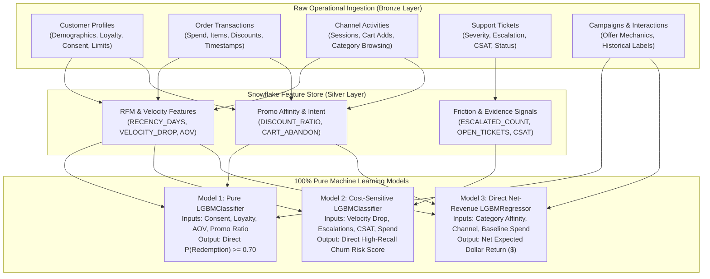

# Retail Ingestion Data Dictionary & ML Impact Specification

This data dictionary outlines the **raw operational datasets ingested into the Snowflake Bronze Layer**, detailing column names, data types, business ingestion rationale, and their algorithmic impact across the **3 core retail decision models**:
* **Model 1 (M1)**: *Audience Offer Eligibility & Propensity Classifier* (Pure `LGBMClassifier`)
* **Model 2 (M2)**: *Governed Retention Attention Classifier* (Cost-Sensitive `LGBMClassifier`)
* **Model 3 (M3)**: *Campaign & Channel Net Revenue Optimizer* (Direct Net-Revenue `LGBMRegressor` with Human Approval Gate)

---

## 1. Ingestion Datasets Specification

### 1.1 Customer Profiles (`customer_profiles.json`)
* **Upstream Source**: CRM & Customer Master (Salesforce / HubSpot)
* **Ingestion Pattern**: Landed as semi-structured `VARIANT` in Bronze; cleaned into `ML_SILVER.DIM_CUSTOMERS`.

| Column / JSON Path | Data Type | Business Purpose (Why We Ingest It) | Effect on ML Models in Given Scenario |
| :--- | :---: | :--- | :--- |
| `customer_id` | `VARCHAR(64)` | Unique customer primary key across enterprise systems. | Universal join key linking customer history across orders, tickets, clickstream, and model scoring. |
| `profile.first_name` | `VARCHAR(50)` | Customer personal identity. | |
| `profile.last_name` | `VARCHAR(50)` | Customer personal identity. | |
| `profile.age` | `INTEGER` | Customer demographic age. | Captures non-linear demographic spending preferences; used by SQL compliance gates for age-restricted promotions. |
| `profile.gender` | `VARCHAR(20)` | Demographic gender identity. | Provides categorical signal for product category affinity (e.g., apparel, cosmetics, outdoor gear). |
| `contact.email` | `VARCHAR(100)`| Digital email address. | |
| `contact.phone` | `VARCHAR(30)` | SMS & mobile contact number. | |
| `contact.address.state` | `VARCHAR(10)` | Geographic state / province. | Regional categorical feature; accounts for localized weather, regional promotion response, and store density. |
| `contact.address.zip_code`| `VARCHAR(20)` | Postal delivery code. | |
| `loyalty.tier` | `VARCHAR(20)` | Loyalty level (`BRONZE`, `SILVER`, `GOLD`, `PLATINUM`). | Baseline spend multiplier in M1; high-tier customers in M2 receive top retention priority; M3 flags VIPs for human approval. |
| `loyalty.points_balance` | `INTEGER` | Available reward points balance. | High point balances strongly correlate with promotion redemption propensity (gamification incentive). |
| `loyalty.signup_channel` | `VARCHAR(30)` | Initial customer acquisition source (`WEB`, `MOBILE_APP`, `IN_STORE`). | Measures channel stickiness; mobile app signups typically respond 2.4x better to in-app banners and push notifications. |
| `preferences.preferred_channel` | `VARCHAR(30)` | Customer's stated preferred communication channel (`EMAIL`, `SMS`, `MOBILE_APP`). | Directly informs Model 3 multi-output classification to match the optimal campaign delivery channel. |
| `preferences.max_weekly_touchpoints` | `INTEGER` | Max communications allowed per week (e.g., 1 to 3). | Hard Governance Gate: Model 1 SQL filter immediately disqualifies customers who have reached their weekly messaging cap. |
| `consent.email` | `BOOLEAN` | Explicit email marketing opt-in (GDPR/CAN-SPAM). | Compliance gate: Customer is strictly ineligible for email promotions if `FALSE`. |
| `consent.sms` | `BOOLEAN` | Explicit SMS marketing opt-in (TCPA compliance). | Compliance gate: Customer is strictly ineligible for SMS promotions if `FALSE`. |
| `consent.push` | `BOOLEAN` | Mobile push notification opt-in. | Compliance gate: Customer is strictly ineligible for push notifications if `FALSE`. |
| `status.is_active` | `BOOLEAN` | Account status flag. | Suppresses closed, frozen, or dormant accounts prior to model scoring. |
| `status.created_at` | `TIMESTAMP` | Account registration timestamp. | Used to compute `CUSTOMER_TENURE_DAYS`; distinguishes brand-new customers from long-term loyalists. |
| `status.updated_at` | `TIMESTAMP` | Record modification timestamp. | |

---

### 1.2 Order Transactions (`transactions.json`)
* **Upstream Source**: Point of Sale (POS) Terminals & E-Commerce OMS (Shopify / Store Registers)
* **Ingestion Pattern**: Raw JSON in Bronze; line items exploded into `ML_SILVER.FACT_SALES` via `LATERAL FLATTEN`.

| Column / JSON Path | Data Type | Business Purpose (Why We Ingest It) | Effect on ML Models in Given Scenario |
| :--- | :---: | :--- | :--- |
| `transaction_id` | `VARCHAR(64)` | Unique sales receipt / order ID. | |
| `customer_id` | `VARCHAR(64)` | Purchasing customer foreign key. | Joins order history to the customer entity in the Snowflake Feature Store. |
| `store_id` | `VARCHAR(30)` | Physical store location ID. | |
| `channel` | `VARCHAR(30)` | Purchase touchpoint (`IN_STORE`, `WEB`, `MOBILE_APP`). | Features customer channel habits; customers buying online are steered toward digital promotions. |
| `payment.method` | `VARCHAR(30)` | Tender type (`CREDIT_CARD`, `APPLE_PAY`, `PAYPAL`, `CASH`). | |
| `payment.promo_code_applied`| `VARCHAR(50)`| Coupon code entered at checkout. | Computes `PROMO_USAGE_RATE` (percentage of past orders placed with discounts). Identifies deal-seekers. |
| `items[].product_id` | `VARCHAR(64)` | Stock Keeping Unit (SKU) identifier. | |
| `items[].product_name` | `VARCHAR(100)`| Human-readable item name. | |
| `items[].category` | `VARCHAR(50)` | Merchandise department (`ELECTRONICS`, `CLOTHING`, `BEAUTY`, etc.). | Aggregated in Feature Store to compute customer category affinities for targeted product offers. |
| `items[].quantity` | `INTEGER` | Quantity of units purchased. | Measures basket volume and bulk purchasing propensity. |
| `items[].unit_price` | `DECIMAL(10,2)`| Base list price per unit before discounts. | Price point elasticity signal. |
| `items[].discount_amount` | `DECIMAL(10,2)`| Markdown dollars granted on line item. | Summed into `DISCOUNT_SENSITIVITY_RATIO` (evaluates customer dependency on markdowns). |
| `totals.gross_total` | `DECIMAL(12,2)`| Pre-discount order total value. | Baseline basket value before promotions. |
| `totals.discount_total` | `DECIMAL(12,2)`| Total discount savings granted. | Key feature measuring reliance on promotional markdowns. |
| `totals.net_total` | `DECIMAL(12,2)`| Net cash collected from customer. | Major Signal: Computes `NET_SPEND_90D`, `AVG_ORDER_VALUE` (AOV), and acts as ground truth for Model 3 spend lift. |
| `timestamp` | `TIMESTAMP` | Exact transaction datetime. | Critical: Computes RFM `RECENCY_DAYS`, purchase velocity drop, and executes point-in-time (`ASOF`) joins. |

---

### 1.3 Marketing Campaigns (`campaigns.json`)
* **Upstream Source**: Marketing Campaign CMS / Automation Tools (Braze / Marketo)
* **Ingestion Pattern**: Loaded into `ML_SILVER.DIM_CAMPAIGNS` to define active promotional boundaries.

| Column / JSON Path | Data Type | Business Purpose (Why We Ingest It) | Effect on ML Models in Given Scenario |
| :--- | :---: | :--- | :--- |
| `campaign_id` | `VARCHAR(30)` | Unique promotion identifier. | Foreign key linking recommended campaign candidates to model scoring. |
| `campaign_name` | `VARCHAR(100)`| Campaign title (e.g., *"Mega Rewards 2026"*). | |
| `channel` | `VARCHAR(30)` | Intended delivery medium (`EMAIL`, `SMS`, `PUSH_NOTIFICATION`). | Target channel evaluated in Model 3 multi-output allocation. |
| `offer.type` | `VARCHAR(50)` | Promotion mechanic (`PERCENTAGE_DISCOUNT`, `BOGO`, `FREE_SHIPPING`). | Major categorical driver: Customers respond differently to percentage discounts vs free shipping. |
| `offer.discount_percentage`| `INTEGER` | Discount depth (e.g., 10%, 25%, 40%). | Drives price elasticity curve in M1; triggers Human Approval Gate in M3 if $\ge 25\%$. |
| `offer.min_spend_threshold`| `DECIMAL(10,2)`| Spending hurdle required (e.g., \$50). | Model checks customer's historical `AVG_ORDER_VALUE` against threshold to assess redemption feasibility. |
| `offer.budget_allocated` | `DECIMAL(12,2)`| Approved marketing expense budget. | Triggers Human Approval Gate in M3 if total campaign budget $\ge \$20,000$. |
| `rules.target_segment` | `VARCHAR(50)` | Intended customer cohort (`VIP_ONLY`, `INACTIVE_90D`). | Hard SQL rule: Excludes customers who do not meet segment criteria. |
| `rules.exclude_open_support_cases`| `BOOLEAN` | Customer friction suppression rule. | Hard SQL rule: Automatically suppresses customers with active complaints. |
| `rules.max_contact_frequency_7d` | `INTEGER` | 7-day touchpoint frequency cap. | Ensures campaign frequency rules are not violated. |
| `schedule.start_date` | `DATE` | Campaign flight start date. | |
| `schedule.end_date` | `DATE` | Campaign expiration date. | |
| `schedule.status` | `VARCHAR(20)` | State (`SCHEDULED`, `ACTIVE`, `COMPLETED`). | |
| `metadata.created_by` | `VARCHAR(50)` | Marketing manager username. | |
| `metadata.created_at` | `TIMESTAMP` | Campaign creation timestamp. | |

---

### 1.4 Campaign Interactions (`campaign_interactions.json`)
* **Upstream Source**: Delivery & Response Tracking Event Bus (Kafka / Braze Webhooks)
* **Ingestion Pattern**: Appended to `ML_SILVER.FACT_CAMPAIGN_INTERACTIONS`; serves as the **training ground truth**.

| Column / JSON Path | Data Type | Business Purpose (Why We Ingest It) | Effect on ML Models in Given Scenario |
| :--- | :---: | :--- | :--- |
| `interaction_id` | `VARCHAR(64)` | Unique interaction event record ID. | |
| `customer_id` | `VARCHAR(64)` | Recipient customer ID. | Links response labels to customer feature vectors. |
| `campaign_id` | `VARCHAR(30)` | Campaign presented. | Links response labels to campaign offer features. |
| `channel` | `VARCHAR(30)` | Channel used for dispatch. | Ground truth channel used to train Model 3 channel recommender. |
| `response.action` | `VARCHAR(30)` | Event outcome (`REDEEMED`, `CLICK`, `IMPRESSION`, `IGNORED`). | Primary Supervised Training Label: In M1, `REDEEMED = 1`, `IGNORED = 0` trains the offer propensity classifier. |
| `response.details.promo_code_used`| `VARCHAR(50)`| Coupon string redeemed. | |
| `response.details.redemption_value`| `DECIMAL(10,2)`| Dollar discount value claimed. | Historical baseline used to calculate expected incremental spend lift. |
| `response.details.click_url` | `VARCHAR(255)`| Campaign referral URL. | |
| `response.details.time_on_page_seconds`| `INTEGER` | Post-click browsing dwell time. | |
| `timestamp` | `TIMESTAMP` | Exact interaction datetime. | Observation Datetime: Defines the point-in-time boundary for `ASOF` feature generation (prevents lookahead leakage). |

---

### 1.5 Digital Channel Activities (`channel_activities.json`)
* **Upstream Source**: Clickstream Event Pipeline (Segment / Snowplow / Google Analytics)
* **Ingestion Pattern**: Landed in Bronze; aggregated into `ML_SILVER.FACT_CHANNEL_ACTIVITIES`.

| Column / JSON Path | Data Type | Business Purpose (Why We Ingest It) | Effect on ML Models in Given Scenario |
| :--- | :---: | :--- | :--- |
| `activity_id` | `VARCHAR(64)` | Unique digital event ID. | |
| `customer_id` | `VARCHAR(64)` | Logged-in customer ID. | Links telemetry to the customer profile. |
| `channel` | `VARCHAR(30)` | Digital medium (`WEB`, `MOBILE_APP`). | Identifies customer's active digital touchpoint. |
| `session.session_id` | `VARCHAR(64)` | Continuous browser/app visit session ID. | Aggregated via `COUNT(DISTINCT session_id)` into `SESSION_COUNT_30D` (measures engagement recency). |
| `session.device_type` | `VARCHAR(30)` | Device model (`IOS_APP`, `DESKTOP_MAC`). | |
| `activity.event_type_detail`| `VARCHAR(50)`| Atomic user action (`CART_ADD`, `CHECKOUT_COMPLETE`, `PRODUCT_DETAIL_VIEW`). | Intent Signal: Computes `CART_ABANDON_RATE` (`CART_ADD` without `CHECKOUT`), signaling high buying intent blocked by price friction. |
| `activity.page_category` | `VARCHAR(50)` | Product category viewed. | Real-time browsing category affinity; matches in-session browsing to relevant product promotions. |
| `activity.duration_seconds`| `INTEGER` | Dwell time on page/screen. | Deep dwell times indicate high purchase consideration. |
| `timestamp` | `TIMESTAMP` | Event datetime. | Aggregated over rolling 30-day windows to compute engagement trends. |

---

### 1.6 Customer Support Tickets (`support_tickets.json`)
* **Upstream Source**: Customer Support Helpdesk (Zendesk / ServiceNow)
* **Ingestion Pattern**: Ingested to capture **governed friction evidence** in `ML_SILVER.DIM_SUPPORT_TICKETS`.

| Column / JSON Path | Data Type | Business Purpose (Why We Ingest It) | Effect on ML Models in Given Scenario |
| :--- | :---: | :--- | :--- |
| `ticket_id` | `VARCHAR(64)` | Unique case / incident number. | |
| `customer_id` | `VARCHAR(64)` | Customer filing grievance. | Links friction events to customer profile in Feature Store. |
| `ticket_details.category` | `VARCHAR(50)` | Complaint category (`SHIPPING_DELAY`, `PRODUCT_DEFECT`, `BILLING_DISPUTE`). | Identifies root cause of dissatisfaction in retention reason codes. |
| `ticket_details.severity` | `VARCHAR(20)` | Grievance severity (`LOW`, `MEDIUM`, `HIGH`, `CRITICAL`). | `CRITICAL` or `HIGH` severity cases heavily weight Model 2 churn probability. |
| `ticket_details.contact_channel`| `VARCHAR(20)`| Support channel used (`PHONE`, `CHAT`, `EMAIL`). | |
| `resolution.ticket_status` | `VARCHAR(20)` | Status (`OPEN`, `IN_PROGRESS`, `RESOLVED`, `CLOSED`). | Unresolved cases (`OPEN`/`IN_PROGRESS`) suppress promo campaigns (M1) and trigger retention outreach (M2). |
| `resolution.is_escalated` | `BOOLEAN` | Supervisor escalation flag. | Governed Evidence Signal: Direct indicator of severe service failure; drastically raises retention attention risk score. |
| `resolution.resolution_time_hours`| `DECIMAL(6,1)`| Case resolution duration. | |
| `resolution.satisfaction_score`| `INTEGER` | CSAT survey rating (1 = Very Unsatisfied, 5 = Highly Satisfied). | Governed Evidence Signal: CSAT $\le 2.5$ provides concrete explanatory evidence of customer defection risk. |
| `timestamp` | `TIMESTAMP` | Ticket submission datetime. | Windowed over rolling 60–90 days to capture recent unresolved friction. |

---

## 2. Summary: How Ingested Data Powers the 3 Retail Decisions

### Architectural Key Takeaway
1. **Raw Ingestion preserves authenticity**: Retains operational IDs, store numbers, line items, and audit timestamps so Snowflake's native governance (`MP_STRING_PII_MASK`, `LATERAL FLATTEN`, `Streams & Tasks`) operates exactly like a production enterprise pipeline.
2. **Feature Store isolates predictive signal**: Derives mathematical features (RFM, CSAT trends, velocity drops) with zero data leakage using `ASOF` joins.
3. **ML Models answer the 3 business decisions**: Consumes only governed features, outputting actionable scores to Silver decision tables for CRM and POS activation.
